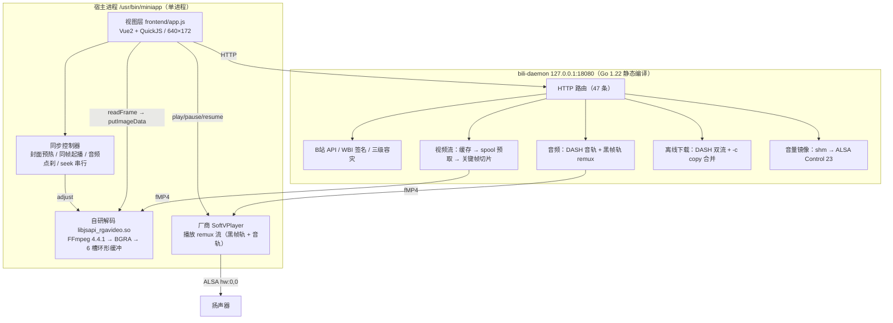

# 笔上哔哩 (BiliPen)

网易有道词典笔 A7（型号 `Y09`，瑞芯微 RV1106）上的哔哩哔哩轻应用：Falcon 运行时（Vue2 + QuickJS）前端 + 本地 Go 守护进程 + 自研 C 解码模块 + 厂商音频播放器。

**当前版本：v3.0.2** · 版本演进见 [CHANGELOG.md](CHANGELOG.md)

> **证据标注约定**
> - **【实测】**：在真机（`YoudaoDictionaryPen-019`，serial `7FC2800009702019`，内核 `5.10.160 #49 armv7l`）上用命令采集到的输出或数值，§九 给出了采样条件。
> - **【源码】**：仓库代码或随仓库提交的二进制里可以直接查到。
> - **【规格】**：芯片/系统的厂商文档（datasheet、配置文件、二进制字符串）。
> - **【未验证】**：尚未复现的说法或推断，文中都会显式标出，**不作为结论使用**。设备上「没找到」一律写成「未发现」，不等于「不存在」；只有规格或设计文档明确的部分才写成「没有」。

---

## 目录

1. [目标设备与硬约束](#一目标设备与硬约束)
2. [系统架构](#二系统架构)
3. [功能现状](#三功能现状)
4. [播放引擎](#四播放引擎)
5. [Go 守护进程](#五go-守护进程)
6. [native 解码模块](#六native-解码模块)
7. [设备与平台事实](#七设备与平台事实)
8. [构建与部署](#八构建与部署)
9. [真机实测数据](#九真机实测数据)
10. [已知限制与待做](#十已知限制与待做)
11. [踩坑与已验证现象](#十一踩坑与已验证现象)
12. [仓库结构](#十二仓库结构)
13. [v3.0.2 发版记录](#十三v302-发版记录)

---

## 一、目标设备与硬约束

| 维度 | 实测/源码事实 | 依据 |
|---|---|---|
| **CPU** | 单核 Cortex-A7（`part 0xc07`），32 位 ARMv7，含 `neon vfpv3 vfpv4 idiva idt` + hard-float ABI | 【实测】`/proc/cpuinfo` |
| **内存** | RAM **92,764 kB**；swap **512MB**（`/userdisk/swap/swap.file`，swappiness=50，由 `/etc/init.d/S01systeminit` 调 `en_swap.sh`） | 【实测】`/proc/meminfo`、`/proc/swaps` |
| **显示** | `/dev/fb0` 物理 **172×640**、16bpp、stride 344B；逻辑分辨率 **640×172**（`cfg.json` 的 `direction:270`、`fps_max:45`、`dbuffer:true`） | 【实测】`/sys/class/graphics/fb0/*`、`cfg.json` |
| **C 库** | uClibc-ng：`ld-uClibc.so.1`、`libc.so.1`；**未发现** `libc.so.6` | 【实测】`/lib` |
| **网络栈** | Go 侧全链路用 `DialContext(ctx, "tcp4", …)` | 【源码】`bili_api.go` |
| **电源策略** | 空闲 30s 降亮、60s 熄屏、600s 关机；`hal-screen keep` 单次续亮 30s，前端每 20s 调一次 | 【实测】`/etc/input-event-daemon.conf`、`hal-screen` 用法串；【源码】`app.js` |
| **进程守护** | `guardian_run` 共 14 个实例托管系统服务 | 【实测】`ps` |
| **「15s 内崩 5 次整机重启」** | 未在 `guardian_run` 二进制中找到相关常量 | 【未验证】 |

直接影响实现的几条：RV1106 没有视频解码单元——Datasheet Rev 1.7 §1.2.4「Video CODEC」只列 Video Encoder，全文不出现 decode（见 §7.5），因此解码全部由 CPU 软解完成；画布内存序是 BGRA（见 §7.2），色彩转换必须按此配置；系统音量对应的 0–100 值由 daemon 从 SysV 共享内存读取再写进 DAC 控件（见 §7.4）。

---

## 二、系统架构



### 一次播放的调用链【源码】

1. 前端点播放 → `rgav.start('http://127.0.0.1:18080/api/stream?bvid=…')`；
2. daemon 按序尝试：本地缓存 → spool 预取 → 关键帧切片（`ffmpeg -ss <ss> -c:v copy -an -f mp4 pipe:1`）→ 实时代理；
3. `rgavideo` 的解码线程：解复用 → H.264 软解 → `sws_scale` 转 BGRA → 写 6 槽环形缓冲；
4. 前端每 8ms 轮询 `readFrame()`，有帧就 memcpy 进 `ImageData` 并 `putImageData`（输出对齐显示区 306×172）；
5. 音频请求 `/api/audio?bvid=…&variant=remux`：daemon 调用设备 `/usr/bin/ffmpeg` 把 DASH 音轨 `-c:a copy` 与一条 `160×90@1fps` 黑帧视频轨重封装成 fMP4，交给厂商 `SoftVPlayer` 播放。

**remux 为什么要带一条视频轨**：厂商库 `libjsapi_softvideo.so` 内含 `streamDecoder init failed` 等字符串【源码·二进制】；运行日志里厂商 init 阶段打印 `find video stream index`【记录值·设备日志】；纯音频 m4s 打开失败为本项目自 v2.x 起的记录现象。因此 `audio.go` 用 `-f lavfi -i color=c=black:s=160x90:r=1` 合成一条视频轨【源码】。

---

## 三、功能现状

### 浏览层（640×172 三栏骨架）

- **左栏**：首页 / 历史 / 我的 三个图标，**长按 600ms** 显示名称
- **顶部动作栏**：标题 + 搜索 / 历史 / 收藏 / 缓存 / 刷新
- **内容区**：2×2 卡片网格 + 右侧翻页列（`n/m` + 上/下）；首页翻到末页再按「下」换一批并回第 1 页
- **推荐流**：WBI 签名接口 → 热门榜单 `ranking/v2` → `/userdisk/bili_feed_cache.json` 三级容灾
- **搜索**：系统原生输入法；视频 / UP主 × 综合 / 播放 / 最新
- **历史**：本地 `/userdisk/bili_history.json`（上限 60 条）+ 云端（需登录）
- **收藏 / 缓存**：收藏夹列表 → 内容网格；缓存列表显示剩余空间并可删除

### 播放页（左 306×172 视频 + 右 334×172 详情）

- **控制条**：暂停 / 快退 10s / 进度条（**只点击跳转，不支持拖动**）/ 快进 10s / 时间；播放中默认隐藏，单击画面唤出，3.5s 自动收起；双击画面 = 暂停/继续；左上 `‹` 返回
- **四标签**：详情 · 分P（原地切换）· 评论（最热/最新/翻页）· 推荐（点选换播）
- **操作行**：赞 / 投币 / 收藏 / 下载 / 更多（稍后再看、一键三连）
- **看视频**：自研 native 软解，实测 25~30 draws/s（见 §九）
- **听视频**：最高码率 AAC 音轨，daemon remux 后由厂商播放器播出
- **离线播放**：DASH 双流下载 + `-c copy` 合并

### 账号

手机 B 站 App 扫码登录，凭证持久化；点赞/收藏/评论/云端历史需登录。

### 未实现或平台不支持

- **弹幕**：仓库内无弹幕接口与渲染层
- **系统手势返回**：手势只触发 `page onHide`，未收到 `onBackPressed`【记录值】；应用内返回走 `‹` 与各页返回控件
- **投币**：接口返回人机验证错误（`-401` + `verify_captcha`【记录值】），应用未实现该流程，只提示去手机端操作

---

## 四、播放引擎

### 4.1 起播状态机【源码】

`playerState`：`idle → loading → ready-paused → playing ⇄ seeking → error / finished`。进入播放页不直接开播：

1. `rgav.start()` 后由 `_coverTick` 等 `primed`，读到首帧立刻 `putImageData` + `rgav.pause()`，画面冻结在 0s（`coverHold=1`），中央显示大播放键；
2. 同时 `_prewarmAudio()` 预热厂商播放器；
3. 首个 `onPosition` 到达时 `pause()` 把音频停在当前位置，记入 `_audioParkAt`；
4. 用户点播放：`audioPlayer.resume()` 与 `rgav.resume(off=a)` 在同一个 tick 发出——音频从 a 继续，视频跳过 a 秒内容。

实测时序（BV1JRHP6BESG，单次采样）：

```text
14.751  [Cover] held at 0s primed=1          ← 首帧就绪（距 start 3.28s）
14.871  [Rga] audio started                  ← remux 流起
18.715  [Cover] audio parked at 1.00s        ← 厂商播放器首个 onPosition（3.84s）
21.183  [Cover] resume both at 1.00s         ← 用户点播（人工间隔 2.47s）
```

> `onInfo` 里有一条 2800ms 兜底会调 `_syncResume(…, 0.5)`，它会在用户点播放前放行视频并置 `_syncDone`，导致之后进不去同步分支【源码】。现 `onInfo` 与 `_syncResume()` 开头都对 `coverHold` 直接 return，`resumeFromCover()` 进入时重置 `_syncDone`。

### 4.2 native 时间轴语义【源码】

| 接口 | 实现 | 语义 |
|---|---|---|
| `resume(off)` | `t0 = now - pts - off` | 视频内容跳过 `off` 秒（配合「落后 >80ms 丢帧」是真跳内容） |
| `pause()` / `unpause()` | `t0 += pause_delta` | 冻结/恢复，恢复时把冻结时长补回时间轴 |
| `adjust(d)` | `skip_until = position + d; t0 -= d` | `d>0.02` 跳帧追、`d<−0.005` 刹车，死区空操作；JS 入口钳 ±2.0s，循环内再钳 ±1.0s |

`info().position` 返回内容 PTS，不是墙钟差；跨 seek 比较时必须补回 `_seekOffset`。

### 4.3 音画同步：音频为主时钟 + 跑前点刹

厂商 `onPosition` 回传整数秒，约 1.08s 一次【实测】；前端用斜率回归 `_acSlope` 外推成连续时钟。运行期规则【源码】：

- `drift = audioClock − videoPos`（>0 表示视频落后）；
- `drift > 0.45s` → `_parkAudio()` 暂停音频等待，视频继续；
- `audioCbPos − videoNow ≤ 0.12s` 时 `_unparkAudio()`；
- `|drift| ≤ 0.45s` 内做 EWMA 微调（每次 30~50ms，最大 120ms）。

**一次补偿实验的结果【实测】**：稳态 `drift ≈ −0.49s`，117 条 `[Sync]` 记录里 112 条是 `lead-brake`（刹视频）。据此假设这是整数秒量化误差，加 +0.5s 补偿后 `lead-brake` 归零、`maxgap` 中位降到 41ms；但继续播放 60s 后 `apos−pos` 从 −1.0s 扩大到 −4.4s（3 分钟 −6.3s，约 **7.3%/分钟**）。该速率与每秒一次 50~120ms 的刹车（≈5~12%）同一量级，因此不能把刹车当作误判剔除。所有补偿改动已回退。

> 【未验证】上面只测到「加了补偿就会持续拉开」与「刹车幅度与拉开速率同量级」这两件事。至于拉开的具体来源（是否等于厂商播放器的音频内容速率偏慢），没有直接测厂商播放器的输出速率，因此不作为结论。

### 4.4 跳转串行化【源码】

`seekTo()` 每次要「停音频 → 停 native → 重建缓冲 → 重启解码」，连点会叠加：

```javascript
if (this._seekBusy) { this._pendingSeekTo = targetSec; return; }   // 只记最后一次
if (now - this._lastSeekAt < 900) { /* 延迟补跳 */ return; }
this._seekBusy = true;
```

`_nativeTick` 读到新帧即清 `_seekBusy`，150ms 后补跳挂起目标；另有 10s 超时兜底。连点快进曾导致过进程崩溃【记录值】；本轮带串行化的实测中未复现。

### 4.5 渲染节拍【源码】

- 8ms 轮询 + 33.34ms 截止时间制出帧；
- 空帧连续 3 次退避一帧；
- `[Perf]` 每 2s 输出 `draws/s avg maxgap pos apos cp dur drg out`；
- 进度条用 `transform: scaleX()` + CSS 过渡，`_updateProgress` 500ms 一次且带 0.3% 变化阈值；进度条三个元素去掉了 `borderRadius`。

---

## 五、Go 守护进程

`bili_src/` 共 11 个源文件（v3.0.2 起含 `alsa.go`），`GOOS=linux GOARCH=arm GOARM=7 CGO_ENABLED=0` 静态编译，监听 `127.0.0.1:18080`【源码】。

| 文件 | 职责【源码】 |
|---|---|
| `main.go` | 路由注册（47 条）、待机看门狗、CPU/线程采样、`closeInheritedFDs()` |
| `bili_api.go` | B 站 Web API：WBI 签名、`dial tcp4`、Feed 三级容灾、DASH 协商（只接受 `codecid==7` AVC）、搜索/详情、扫码登录、封面与二维码缓存 |
| `stream.go` | 视频流：600 MiB 上限缓存（超限按最近访问时间淘汰，跳过正在写入的 spool 与正在播放的 bvid）、spool 预取、关键帧切片（`&ss=`）、`proxyUpstream` 空闲看门狗、`/api/stream/status` |
| `audio.go` | 音频：DASH 音轨 + 黑帧轨重封装、`chrt -f 49`、16×16KiB 分块读取通道、`/api/alsa/ready` 探针、会话取消 |
| `alsa.go` | 听视频 ALSA 直出（`/api/audio/alsa*`），单实例 ffmpeg 写 `hw:0,0`，设备忙时回 409 |
| `volume.go` | 每 100ms 读 SysV shm `0x7663746c` 偏移 +4，按 `round(vol*30/100)` 写 ALSA Control 23 |
| `history.go` | 本地观看历史（`/userdisk/bili_history.json`，上限 60 条） |
| `download.go` | 离线下载：DASH 双流、Range 断点续传、暂停/恢复、`-c copy` 合并 |
| `cache.go` | 在线缓存清单与清理（跳过 `.part` 与正在播放/写入的文件） |
| `actions.go` | 互动：点赞/投币/收藏/评论/分P/推荐/云端历史/稍后再看/收藏夹/登录；`csrfToken`、`ensureLogin`、`ensureBuvid` |

### 关键机制【源码】

- **IPv4**：全程 `DialContext(ctx, "tcp4", addr)`。
- **Feed 三级容灾**：WBI 推荐 → `ranking/v2` → `/userdisk/bili_feed_cache.json`。
- **关键帧切片**：`ffmpeg -ss <s> -i <src> -c:v copy -an -movflags frag_keyframe+empty_moov+default_base_moof -f mp4 pipe:1`，不重编码。
- **预取限速**：播放期间对其他 bvid 的预取按 512 KiB/s 计速（`paceDownload`）；当前播放的 bvid 与空闲时不限速。
- **断点续传**：`.v.part`/`.a.part` 按已下载字节发 `Range:`；`206` 校验 `Content-Range` 起点，`200` 才回退重写；最多 4 轮重试，重试前分别等待 2/4/8s，每轮重新 `resolveDash()`。
- **待机退出**：每 30s 检查，息屏且无播放、无下载满 20 分钟时 `server.Shutdown` 并退出。
- **清理继承 fd**：daemon 由前端 shell 拉起，会继承宿主已打开的 fd。历史上出现过 daemon 持有 `/dev/snd/pcmC0D0p` 时厂商播放器无声的现象，现启动时只关闭继承来的 fd（`closeInheritedFDs()`）。

### 接口清单（47 条，`grep` 实测计数）

| 分组 | 接口 |
|---|---|
| 基础 | `/api/ping` `/api/health` `/api/status` `/api/metrics` |
| 内容 | `/api/feed` `/api/trending` `/api/search` `/api/detail` `/api/parts` `/api/selectcid` `/api/related` `/api/comments` `/api/proxy/cover` |
| 播放 | `/api/play` `/api/stream` `/api/stop` `/api/audio`（`variant=remux\|raw`）`/api/alsa/ready` `/api/stream/status` |
| 听视频直出 | `/api/audio/alsa`（`cmd=start\|stop\|pause\|resume\|seek`）`/api/audio/alsa/status` |
| 下载 | `/api/download/start` `/api/download/list` `/api/download/status` `/api/download/pause` `/api/download/delete` |
| 缓存 | `/api/cache/list` `/api/cache/delete` `/api/cache/clear` |
| 历史 | `/api/history` `/api/history/add` `/api/history/clear` `/api/history/cloud` |
| 互动 | `/api/action/relation` `/api/action/like` `/api/action/coin` `/api/action/fav` `/api/fav/folders` `/api/fav/items` `/api/toview/add` `/api/share/qr` |
| 账号 | `/api/user/info` `/api/login/qr` `/api/login/poll` `/api/login/state` `/api/login/logout` |
| 其他 | `/api/volume` |

`/api/stream/status` 返回 `{bvid, source, have, total, done, percent, ss}`，`source` 取值为 `offline|cache|spool|slice|direct|idle`；切片源无总量时 `percent=-1`【源码+实测】。

---

## 六、native 解码模块

`native/rgavideo.c`（915 行）编译为 `libjsapi_rgavideo.so`（**22,064 字节**，ARMv7/uClibc），由前端通过 `import('rgavideo')` 取 `default` 使用。

### 编译（仅改 C 源码时需要）

```bash
TC=~/a7tc/arm-rockchip830-linux-uclibcgnueabihf
$TC/bin/arm-rockchip830-linux-uclibcgnueabihf-gcc -shared -fPIC -O2 \
  -fvisibility=hidden -I~/a7build -I~/a7build/ffmpeg-4.4.1 \
  -o libjsapi_rgavideo.so native/rgavideo.c \
  -L~/a7build/devlibs -lavformat -lavcodec -lswscale -lavutil -lm -lpthread -ldl \
  -Wl,--allow-shlib-undefined -Wl,-s
```

- 头文件：QuickJS 2020-07-05 的 `quickjs.h`、FFmpeg 4.4.1 源码头（需自行补 `libavutil/avconfig.h`）
- 链接用 `.so` 从设备拉：`adb pull /usr/lib/libavformat.so.58.76.100 devlibs/libavformat.so`（codec/swscale/avutil 同理）
- ELF 判据【实测】：`DT_NEEDED` = `libavformat.so.58` / `libavcodec.so.58` / `libswscale.so.5` / `libavutil.so.56` / `libc.so.0`，**无** `libc.so.6`、**无** `libquickjs.so`；`e_flags = 0x5000400`（含 hard-float）
- 仓库已提交编译产物，普通构建不需要工具链

### 模块契约【源码】

- 导出 `custom_init_jsapis` 与 `jsapi_check_unload`
- 注册：`registerCModuleLoader("rgavideo", loader)` → `JS_NewCModule` + `JS_SetModuleExport("default")`
- 只导出 1 个名字 `default`，其上 **16 个方法**：

| 方法 | 行为 |
|---|---|
| `setBuffer(arrayBuffer, w, h)` | 指定 BGRA 输出缓冲（= `ImageData.data.buffer`）；运行中调用会先内部 `player_stop()`；`w*h*4 > size` 抛 `buffer too small` |
| `start(url)` / `stop()` | 起/停解码线程；`stop()` 会 join |
| `readFrame()` | 有新帧则 memcpy 到 JS 缓冲并返回 1，否则 0 |
| `pause()` / `unpause()` | 冻结/恢复，恢复时补回冻结时长 |
| `resume(off)` | 放行首帧并把内容起点推到 `off` 秒，`off` 仅 `[0,30]` 有效 |
| `adjust(d)` | 纠偏，见 §4.2 |
| `info()` | `{width, height, duration, position, finished, primed}`（每次新建对象） |
| `error()` / `duration()` / `position()` | 单项读取 |
| `setCropMode(0\|1)` | 适应 / 铺满（居中裁切） |
| `setScaleAlgo(0..3)` | `sws_scale` 算法，须在 `start()` 前 |
| `setRGAEnabled(0\|1)` / `rgaAvailable()` | RGA 开关与探测 |

- `jsapi_check_unload()` 返回「当前能否安全 dlclose」：`return g.thread_started ? 0 : 1;`

### 内部行为【源码】

- 通路：解复用 → H.264 软解 → `sws_scale` YUV420→BGRA → 6 槽环形缓冲（约 200ms）→ JS `putImageData`
- 环半满（≥3 槽）时解码主循环每 2ms 轮询、最多等 40ms；环满 6 槽则丢弃该帧、只更新 `position`
- 该帧落后墙钟 >80ms 直接丢弃；持续落后 >1.5s 时重置 `t0`（源码注释：避免只出声音不出画面）
- 输出尺寸由前端 `setBuffer(w,h)` 决定；`640×360` 是未设缓冲时的兜底值

### RGA

- 模块初始化时无条件 `dlopen("librga.so")` 并 `c_RkRgaInit()`；前端 `USE_RGA=false` 调 `setRGAEnabled(0)` 关闭 blit 路径【源码】
- 设备侧 `/dev/rga`（10,127）与 `/usr/lib/librga.so`（158,216 B）存在【实测】
- 【记录值】打开 RGA blit 的一次对比：`draws/s` 30→27、`maxgap` 48→150ms，因此默认关闭。仓库注释把原因归于设备只有可缓存 dma-heap、每次 blit 被内核同步 cache，**该解释未独立验证**

---

## 七、设备与平台事实

### 7.1 内存与分区【实测】

- RAM **92,764 kB**；swap **512MB**（`/userdisk/swap/swap.file`，536,870,912 B）
- `/` = **EROFS**（`/dev/mmcblk0p10`，973MB，只读且已满）；`/userdata` = ext4 235MB；`/userdisk` = ext4 **26GB**
- `/oem` **未出现在 `/proc/mounts`**，是 `/` 下的目录（`du -sh` = 688MB）
- `/tmp` 是 **45MB tmpfs**

### 7.2 显示【实测】

- `/dev/fb0`：`virtual_size 172,640`、`stride 344`、`bits_per_pixel 16`、`name rockchipdrmfb`、`rotate 0`
- `/etc/miniapp/resources/cfg.json`：`screen{width:640,height:172,direction:270,fps_max:45,bpp:16}`、`device{fb:"/dev/fb0",tp:"/dev/input/by-path/hyn_ts"}`
- 画布内存序为 BGRA（源码按此配置 `AV_PIX_FMT_BGRA`）
- **未确认项**：`by-path` 下实际只有 `axs_ts→event2` 等节点，`hyn_ts` 未出现（`cfg.json` 里是旧名）；`direction:270` 的旋转发生在哪一层（`fb0/rotate` 为 0），未定位

### 7.3 输入【实测】

| 节点 | 驱动 | 能力 |
|---|---|---|
| `event0` | `rk805 pwrkey` | `KEY_POWER`(116) |
| `event1` | `gpio-keys` | `KEY_HOME`(102)、`KEY_CAMERA`(212) |
| `event2` | `axs_ts` | `ABS_MT_POSITION_X 0–640`、`Y 0–172`、`BTN_TOUCH`、单指 |
| `event3` | `Typec_Headphone` | `SW_HEADPHONE_INSERT`(4) |
| `event4` | `fake-keys` | 虚拟按键注入 |

- 触控上报范围与逻辑分辨率一致（0–640 / 0–172），前端按 1:1 使用【实测范围 + 源码】
- Falcon 在抬手约 150ms 后会补发一个无坐标的合成 `click`【记录值·此前实测】；前端 `readTouchPoint()` 取不到坐标时返回 null
- 事件对象上的 `stopPropagation` 不保证存在（源码里有 `typeof` 守卫，也有未守卫的调用点）

### 7.4 音频【实测】

- TinyALSA；card0 共 **25 个控件**，其中 numid **23** = `DAC LINEOUT Volume`（0..30）、numid **24** = `DAC HPMIX Volume`（0..2）
- SysV 共享内存 key `0x7663746c`（`'vctl'`）：`ipcs -m` 显示 `bytes=24`、`perms=640`、`shmid=5`；daemon 只读偏移 **+4** 处的 0..100 值
- 实测映射：`system_volume 37 → hw 11`、`47 → 14`、`50 → 15`，与 `round(sys*30/100)` 一致，且 `tinymix -D 0 get 'DAC LINEOUT Volume'` 同值
- `/etc/asound.conf` 的 `pcm.!default → speaker → spk_softvol` 绑在 **card 1**；设备 `/dev/snd` 只有 card 0 的节点 ⇒ `ffmpeg -f alsa default` 报 `Invalid value for card`；实测可用的只有 `hw:0,0`
- **ALSA 独占已复现**：先起的进程占住 `hw:0,0` 时，第二个进程报 `Device or resource busy`

### 7.5 硬件加速

| 能力 | 结论与依据 |
|---|---|
| 视频硬解 | **芯片没有解码单元**：Datasheet Rev 1.7 §1.2.4「Video CODEC」只有 Video Encoder（H.265/HEVC Main Profile L5.0、H.264/AVC High Profile L5.0、JPEG baseline 编码），全文不出现 decode【规格】。设备侧一致：未发现 `/dev/mpp*` 与 `librkmpp.so`【实测】。因此解码全部走 CPU 软解 |
| RGA 2D | `/dev/rga`（10,127）与 `/usr/lib/librga.so` 存在；blit 默认关闭（§六） |
| NEON / VFPv4 | `/proc/cpuinfo` Features 含 `neon vfpv3 vfpv4`，hard-float ABI |
| AV1 解码 | FFmpeg 4.4.1 解 B 站实际 AV1 码流时报 `Failed to read unit … / Not yet implemented in FFmpeg` |

解码单元的依据：[Rockchip RV1106 Datasheet Rev 1.7（2023-12-18）](https://rockchips.net/wp-content/uploads/2025/03/Rockchip-RV1106-Datasheet-V1.7-20231218.pdf) §1.2.4 的完整小节标题只有「Video Encoder」，内含 H.265/H.264 编码与 JPEG baseline 编码；用 `pdftotext` 提取全文后 `decode` 出现 0 次。芯片另含 0.5/1.0 TOPS NPU 与 RKIVE 视觉加速块，均不提供视频解码。设备上的 `/dev/video0`–`/dev/video20`、`/dev/media0-1` 对应摄像头/ISP 链路（逐项用途未核实）。

### 7.6 电源与守护【实测】

- `/etc/input-event-daemon.conf`：`30s = hal-screen down`、`60s = len_onoff.sh off; hal-screen off`、`600s = system_power_off`
- `hal-screen` 用法串含 `keep: keep screen on 30s`；前端每 20s 调一次【源码】
- `guardian_run` 共 14 个实例（托管 `ubusd`、`runDictPen` 等）；「5 次/15s 重启」未找到对应常量【未验证】

### 7.7 AMR 包与安装

- `.amr` 是标准 ZIP（`head -c 8` 得 `PK\x03\x04`，Deflate），无前置头【实测】
- 包内：`manifest.json` + `app_icon.png`(100×100) + `app.js` + `libs/arm/{bili-daemon, libjsapi_*.so}`；`build_bili.py` 只产出 `app.js`，无 `app.js.bin` 分支【源码】
- `cert` 是逐文件 `{size, md5}` 清单（不含 manifest 自身）；任一不符时安装失败（PMS 打印 `md5 check failed`）
- **PMS 会改写并改名 `libs/arm/*.so`**【实测·安装槽内比对】：

| 文件 | cert 记录 | 安装槽实际 |
|---|---|---|
| `app.js` | 210,237 / `7559f843…` | 210,237 / `7559f843…`（一致） |
| `libs/bili-daemon` | 6,422,663 / `ae77b335…` | 6,422,663 / `ae77b335…`（一致） |
| `libjsapi_nekolib.so` | 17,328 / `5aa562e7…` | `libjsapi_nekolib_1638136790.so` 25,196 / `273464d5…` |
| `libjsapi_rgavideo.so` | 22,064 / `38f96c2e…` | `libjsapi_rgavideo_1638136790.so` 30,236 / `a46a7f42…` |
| `libjsapi_softvideo.so` | 188,288 / `8bde3e91…` | `libjsapi_softvideo_1638136790.so` 224,908 / `7f2ecf60…` |

  ⇒ 校验「设备上跑的是不是这份源码」只能用 `app.js` 与 `bili-daemon` 的哈希；改写机制未确认【未验证】
- 上表是 v3.0.1 时的采样；v3.0.2 的 cert/槽内值见 §十三。**`.so` 的改名后缀每次安装都会变**（本次为 `_1136092709.so`，内容也被 PMS 改写），因此它不能用来判断源码版本。
- A/B 双槽：`packages.json` 里 `"b": true` 表示当前槽，实测该应用只保留 `b/`

### 7.8 路径与命令【实测】

```bash
miniapp_cli install /userdisk/x.amr
miniapp_cli start 9002000869905604
miniapp_cli capture /userdisk/shot.png      # 截屏
miniapp_cli memoryUsage                     # QuickJS 堆
miniapp_cli injectKey 116                   # KEY_POWER
killall bili-daemon                         # 设备没有 pkill/pgrep
tinymix -D 0 controls / get 23 / set 23 16
```

| 路径 | 说明 |
|---|---|
| `/usr/bin/miniapp` | 轻应用宿主（单进程） |
| `/userdata/miniapp/data/mini_app/pkg/packages.json` | 应用注册总表（A/B 槽） |
| `/userdisk/secondary/miniapp/data/mini_app/pkg/<appid>/<a\|b>/` | 应用实体目录 |
| `/userdata/applog/DictPen_<启动时刻>.log` | 前端 `console.log` 落点（fd1/fd2 重定向） |
| `/userdisk/bili_daemon.log` | daemon 日志，每次启动截断，时间戳为 UTC |
| `/userdisk/bili_cache` `/userdisk/bili_downloads` `/userdisk/bili_covers` | 在线缓存 / 离线下载 / 封面 |
| `/userdisk/bili_history.json` | 本地历史 |
| `/usr/bin/ffmpeg` `/usr/bin/chrt` | daemon 调用的工具 |

---

## 八、构建与部署

### 依赖

- **Python 3**、**Go 1.22+**（缺 Go 时脚本只告警并复用既有 `bili_src/bili-daemon`【源码】）
- 仅重编 native 时才需要 Rockchip 工具链 `arm-rockchip830-linux-uclibcgnueabihf`(GCC 8.3.0) + FFmpeg 4.4.1 头 + QuickJS 2020-07-05 头

### 打包

```bash
python build_bili.py        # → 9002000869905604.amr
```

流程：交叉编译 `bili_src/` → 复制 `libs/arm/*.so` + 图标 + `app.js` → 重算 `cert` → 打 ZIP。脚本不编译 native。

**构建可复现（v3.0.2 实测）**：同一份源码连跑两次，`bili_src/bili-daemon` 的 md5 均为 `b37487af…`（6,422,663 B）；`.amr` 均为 `e2fbdc43…`（2,809,913 B）。`go build` 参数为 `-trimpath -buildvcs=false -ldflags "-s -w -buildid="`；缺 `-buildvcs=false` 时产物随 git 状态漂移（多出 `.vcs` 段），工作区脏时同样漂移。

> 前提：**同一台机器 + 同一 Go 版本**。跨平台不可复现（zip 条目的 `create_system`、zlib 版本都不同）。
> `-buildvcs=false` 的代价是 `go version -m` 查不到 commit；要溯源只能比对 §十三 里的产物 md5。

### 安装与自检

```bash
adb push 9002000869905604.amr /userdisk/bili.amr
adb shell "miniapp_cli install /userdisk/bili.amr"
adb shell "killall bili-daemon miniapp 2>/dev/null; miniapp_cli start 9002000869905604"
adb shell "curl -s http://127.0.0.1:18080/api/ping"
```

> ⚠️ 已实测：`miniapp_cli install` **不会**让正在运行的页面加载新代码（槽内 md5 已变，运行实例仍是旧 JS），必须重启宿主；`killall miniapp` 也无效，需 `kill -9 <pid>`，宿主随后由系统重新拉起。

### 真机诊断

```bash
adb shell "tail -f /userdata/applog/DictPen_*.log | grep -E '\[Perf\]|\[Sync\]|\[Cover\]|\[Rga\]|\[Seek\]'"
adb shell "ps | grep bili-daemon"; adb shell "top -H -d 1"
adb shell "cat /userdisk/bili_daemon.log"          # daemon 日志（UTC）
adb shell "tinymix -D 0 get 'DAC LINEOUT Volume'"
```

---

## 九、真机实测数据

> 采样条件：v3.0.1，播放 `BV1JRHP6BESG`（dur 242.0s）与 `BV1LAnh6NE9y`，采样窗口为播放中的 12~13s 逐线程窗口与 daemon 的 60 条采样。除特别注明外，同一组数据来自同一次播放。

### 渲染节拍（63 个 `[Perf]` 样本）

| 指标 | min | 中位 | 均值 | max |
|---|---|---|---|---|
| `draws/s` | 0（含启动首样本） | **27** | 26.0 | 30 |
| `avg`（readFrame+putImageData） | 1ms | **1ms** | 1.4ms | 11ms |
| `maxgap` | 0 | **147ms** | 193.8ms | 2745ms |

- `out` 全程为 `306x172`，`drg` 恒为 0
- `maxgap` 分档：≤100ms 15 次 / 101–170ms 37 次 / 171–250ms 4 次 / >250ms 7 次（含 1 次 2745ms）

### CPU（`top -H` 逐线程，两个独立窗口）

| 模式 | 进程总计 | `miniapp` | `video_decoder` | `YAudioModule` | 其余线程 |
|---|---|---|---|---|---|
| 看视频 | 68% / 72% | 60.6% / 63.9% | **4.7% / 4.5%** | 2.8% | 0.0% |
| 听视频 | **13%** | 3.3% | **4.5%** | 2.7% | — |

- 同期应用只打开两路流：`/api/stream`（喂 rgavideo）与 `/api/audio?variant=remux`（喂厂商播放器）
- `video_decoder` 在两种模式下都是 4.5%，与「是否显示真实视频」无关
- 设备侧单独测「纯解 190 帧黑图」为 `utime=0.164s`（≈0.1%），「纯解 3:08 AAC」为 `utime=4.936s`（≈2.6%）。据此，`video_decoder` 的 4.5% 不主要来自黑帧解码本身；**具体花在取流/解封装还是合成，未逐项拆开验证**
- 一次渲染改动的对照：同一视频，改前 `miniapp` 61%、总计 68%；改后 `miniapp` 44%、总计 52%（12s 逐线程采样各一次）

### 音画同步（117 条 `[Sync]` 记录 + 63 条 `[Perf]`）

| 指标 | 值 |
|---|---|
| `drift`（audio−video） | min −0.609s / 中位 **−0.490s** / max +0.442s |
| 分支计数 | `lead-brake` 112 / catch-up 5 / park 4 / caught-up 1 |
| `adjust` 取值 | −0.12×44、−0.05×67、−0.03、+0.031、+0.045、+0.05×3 |
| `[Perf] apos−pos` | min −1.50 / 中位 **−0.90** / max +1.00 |

补偿实验与回退原因见 §4.3。

### 设备 ffmpeg 能力（同一台设备，`/usr/bin/ffmpeg` 4.4.1）

| 测试 | 结果 |
|---|---|
| 解复用 + 探测 DASH 音频 m4s | 识别为 `mp4/m4a`，AAC LC 48kHz stereo，时长 3:08.67 |
| 纯解码（`-f null`） | 退出码 0；188.67s 音频 `utime=4.968s`、`rtime=5.067s`（约 37–38× 实时） |
| 直出 `-f alsa hw:0,0`（`-re`，15s） | 退出码 0，`speed≈0.99–1.00x`，日志内 xrun/underrun 0 次；采样期间系统 idle 90.9% |
| `-f alsa default` | 报 `Invalid value for card`（见 §7.4） |
| 两个进程同时占 `hw:0,0` | 第二个报 `Device or resource busy` |

### remux 成本（按 `audio.go` 的同一组参数复跑）

| 指标 | 实测 |
|---|---|
| 首字节延迟（`pipe:1` + `-flush_packets 1`） | 130ms |
| 全量 remux（3:08 音频） | 2s（`speed=115x`，`utime=1.317s`，`maxrss=16.2MB`） |
| 体积 | 4,481,041 → 4,553,905 B（+72,864 B，+1.63%） |
| 产品流构成 | `aac 48000Hz stereo 188kb/s` + `mpeg4 160x90 1fps`；时长 3:10.00（比输入长 1.33s） |
| 同一素材换真实 360P AVC 视频轨混流 | 25,385,663 B（约为 remux 产物 4,553,905 B 的 5.6 倍），耗时 3s |
| 换真实 AV1 360P 视频轨 | 12,097,172 B（约为 remux 产物的 2.7 倍），耗时 3s，设备解不了（§7.5） |

### 其他

- QuickJS 堆：`memory allocated 121,813 blocks / 974,504 B`；`memory used 6,304,981 B`；单帧 `ImageData` 210,528 B（占 malloc 堆 21.6%）
- 起播：首帧 3.28s、厂商首个 `onPosition` 3.84s（单次采样，见 §4.1）
- 音量映射：见 §7.4（两点采样）

---

## 十、已知限制与待做

### 已知限制

- 退出/切歌后仍有约 1 秒声音【记录值，本轮未复测】；偶发爆音（触发条件未定位）
- 弹幕未实现
- 系统手势返回只触发 `page onHide`，未收到 `onBackPressed`【记录值】
- 投币：接口返回人机验证错误，应用未实现该流程【记录值】
- 守护进程无鉴权，仅绑定 `127.0.0.1`
- 播放固定 letterbox「适应」（v3.0.1 移除了「铺满」切换）
- 听视频 ALSA 直出后端已就位但**前端未接入**（`/api/audio/alsa*` 目前没有调用方，运行时问题暂无用户影响）
- 进度条 seek 是**两段式**：控制条默认收起，第一次单击只唤出控制条，再点轨道才跳转【v3.0.2 真机复核，容易被当成「点了没反应」】
- 进度条点击按 `offsetX`（相对事件目标）换算，点在已填充段上会按填充块坐标映射，落点偏小【源码】
- 看门狗新阈值（20s/15s）与直出 ffmpeg 的 pidfile 回收**均未在真机复现**，只做了编译与静态复核

### 待做（收益均未实测）

- 按 `_acSlope` 做速率匹配出帧（`_nextDue += FRAME_MS / clamp(_acSlope*1000, 0.90, 1.10)`），观察能否减少每秒一次的 `adjust` 与伴随的停顿
- 听视频模式接入 daemon 已有的 ALSA 直出接口：可移除 `video_decoder` 那条管线（该线程实测 4.5%），但要自建位置通道、且 ALSA 独占；净收益未测
- 起播预缓冲：按 `/api/stream/status` 的 `have` 等更多数据再放行
- 音频尾音清理：退出/切 P 时下发静音 PCM 或刷新缓冲
- RGA 加速：需先确认能否拿到 uncached dma-buf
- 弹幕：需新增接口与渲染层
- **ALSA 接线前必须先修**（否则接上就是线上问题）：start 进行中的 `pause` 被静默吞成 200；busy→409 只看 400ms 窗口且只扫 stderr 首行；直写 `hw:0,0` 没有 `-ar/-ac`，44.1k 音轨可能整条不可播；`stop` 只 Kill 不 Wait，紧随的 `start` 可能撞 busy；409 被复用给 `not paused`/`not started`/`superseded` 三种语义
- `saveCookie` 的固定 `.tmp` 名在并发下可能交错（登录轮询 + buvid 回填）：换 `os.CreateTemp` + 互斥
- seek / 切集时 `transform` 上的 450ms 过渡会让进度条「倒放」一次：这两条路径应临时把 `transitionDuration` 置 0
- `curPos` 的 1.0s 写入阈值使时间文本最坏慢一拍：改成 `Math.floor` 比较
- 给 `[Sync] dynamic adjust` 日志补 `_acSlope` 字段，为「音频 0.93x」这个矛盾说法定案

---

## 十一、踩坑与已验证现象

**内存与缓冲**

- 传给 `SoftVPlayer.setImageDataBuffer` 与 `rgavideo.setBuffer` 的缓冲都必须在实例上持续引用；厂商模块会异步写入传入的缓冲【源码·模块行为】。缓冲区曾被回收后出现过崩溃记录【历史现象，因果未严格验证】
- 大 JSON 整块进 QuickJS 会让堆膨胀【记录值：建议在 Go 侧剪裁】

**色彩与尺寸**

- 画布内存序是 BGRA，`sws_scale` 需输出 `AV_PIX_FMT_BGRA`，写成 RGBA 会出现红蓝颠倒【源码 + 历史现象】
- 厂商 `onInfo` 回调参数顺序为 `(width, height, duration)`，写反会把时长当尺寸申请内存【源码 + 历史现象】

**音频**

- `onPosition` 是整数秒【实测】；不要用「比较 a 与 videoPos 大小」的自适应单位判断
- ALSA 独占【实测】：同一时刻只能有一个进程持有 `hw:0,0`
- daemon 若持有继承来的 PCM fd，厂商播放器会没有声音【历史现象，已由 `closeInheritedFDs()` 消除】

**事件与交互**

- Falcon 合成 click 不带坐标；`stopPropagation` 不保证存在
- 进度条只做点击：拖动会连续触发 `seekTo`，每次重开 ffmpeg 切片与解码线程【历史现象】

**下载**

- 弱网下载不能用 30s 总超时的 `streamClient`；需独立 client + Range 续传 + 90s 无字节看门狗【源码】
- 重试不能 `O_TRUNC` 从头写，否则会反复从头下载【历史现象】

**设备操作【实测】**

- `miniapp_cli install` 不重载运行中的页面；`killall miniapp` 无效，需 `kill -9`
- `/tmp` 只有 45MB，空间不足时 `adb push` 仍可能报成功
- Git Bash 下 `adb pull` 会转换远端路径，需 `MSYS2_ARG_CONV_EXCL='*'`
- 校验设备上的代码版本只能比 `app.js` / `bili-daemon` 的哈希

**构建**

- 改过包内文件必须重跑 `build_bili.py`，否则 `cert` 与内容不符
- `go build` 需要 `-buildvcs=false` 才能让产物不随 git 状态变化

---

## 十二、仓库结构

| 路径 | 说明 |
|---|---|
| `README.md` | 本文档（功能 / 架构 / 设备事实 / 构建部署 / 实测 / 踩坑） |
| `CHANGELOG.md` | 版本演进历史（v2.4.0 ~ v3.0.2） |
| `frontend/app.js` | 前端单文件源码（Vue2 + QuickJS） |
| `build_bili.py` | 打包脚本 |
| `bili_src/` | Go 守护进程，11 个源文件（见第五章） |
| `native/rgavideo.c` | native 解码模块源码（915 行） |
| `libjsapi_rgavideo.so` | 预编译 native 模块（22,064 B） |
| `libjsapi_softvideo.so` | 设备自带软解/音频 JSAPI（188,288 B） |
| `libjsapi_nekolib.so` | 设备自带 shell/文件 JSAPI（17,328 B） |
| `app_icon.png` | 应用图标（100×100） |
| `.gitignore` `.gitattributes` | 构建产物与二进制配置 |

构建产物 `9002000869905604.amr` 与 `bili_src/bili-daemon` 不入库。

---

## 十三、v3.0.2 发版记录

`c3dbb61`（v3.0.1）之后的工作区改动已在 v3.0.2 一次性提交，**工作区当前没有未发布代码**。改动的完整说明见 [CHANGELOG.md](CHANGELOG.md)；这里只放「发版时的验证状态」速查，避免把源码改动误当成已验证。

| 项 | 内容 | 出包验证 | 真机验证 |
|---|---|---|---|
| `frontend/app.js` | 进度条 `transform: scaleX()` + 450ms 过渡、`_updateProgress` 200→500ms、去圆角；删除死常量 `AUDIO_QUANT_BIAS` 并校正同步注释 | `node --check` 通过；包内 md5 `924ef4bb…` | 填充起点恒 x=62（`transformOrigin` 生效）、进度与时间文本一致；**450ms 插值本身未验证** |
| `build_bili.py` | `-buildvcs=false`、`os.walk` 排序、打包前 `rmtree` | 连跑两次产物 md5 一致（`e2fbdc43…`） | 不涉及 |
| `bili_src/stream.go` | 看门狗阈值 45s/30s → 20s/15s、读写双向判活、去掉冗余 `Close` | `go vet` + 交叉编译 exit 0 | **未验证**（需构造弱网卡死） |
| `bili_src/alsa.go`（新增） | ALSA 直出接口 + pidfile 回收孤儿 ffmpeg | 编译通过；二进制内可见新日志串 | **未验证**（前端未接入；回收需人为造孤儿） |
| `bili_src/bili_api.go` | AVC-only、DASH 业务错误码归因、Cookie 0600 原子写失败清理 | `go vet` exit 0 | 源码级（AV1/HEVC 不再被自动选中） |
| `bili_src/main.go` | 注册 `/api/audio/alsa*`、`stop` 收尾、启动回收调用、`Version=3.0.2` | 路由 47 条（`grep` 计数） | `/api/ping` 的 `version` 随包更新 |

**产物校验**（部署前用 `md5sum` 比对，流程见 §8）：

| 文件 | 大小 | md5 |
|---|---|---|
| `9002000869905604.amr` | 2,809,913 | `e2fbdc43bcedb40938f399b4f424130f` |
| `libs/arm/bili-daemon` | 6,422,663 | `b37487afd8ec9fa63824c7f38cc52d17` |
| `app.js` | 212,064 | `924ef4bbb1183081161b3e1f369fccb7` |

> 部署后设备槽内 `app.js` 与 `libs/bili-daemon` 的 md5 应与上表一致；`.so` 会被 PMS 改名改写（§7.7），不能用于比对。

---

## 免责声明

本项目为个人学习与研究用途，与哔哩哔哩、网易有道均无关联；仓库内涉及的厂商库与图标版权归原权利人。
