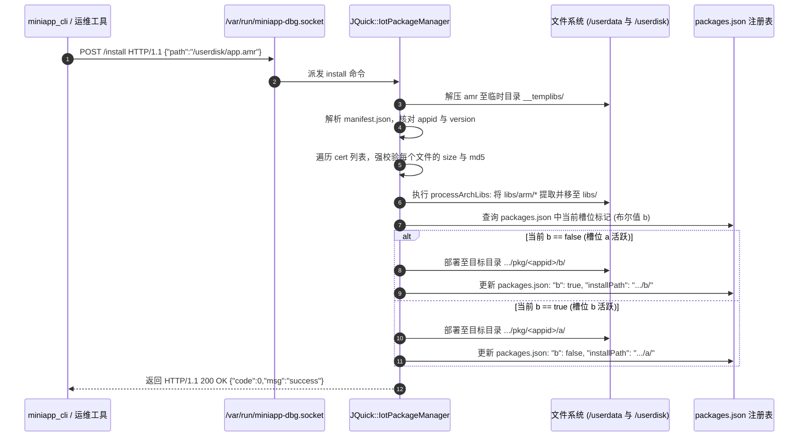

# 网易有道 A7 词典笔软硬件全栈与 Miniapp AMR 开发技术手册

> **文档属性**：工业级底层架构与运行时客观规范手册  
> **适用机型**：网易有道词典笔 A7  
> **系统标识**：主机代号 `YoudaoDictionaryPen-019` | 平台标识 `y09` / `y09_platform` | 设备 SKU `OVERHEAD_Y09_SKU_CHN_PRO` | PCBA 版本 `Y09_RV1106_V0`  
> **固件基线**：Rockchip RV1106 @ ARMv7l Cortex-A7 (Hard-Float) + Linux 5.10.160 + uClibc-ng 32-bit (Buildroot 2021.11)  
> **数据来源**：基于设备真机 ADB 环境实际提取的内核、动态库、配置文件及软件包二进制解析

---

## 目录
1. [第 1 章：设备真实硬件平台与嵌入式系统参数](#第-1-章设备真实硬件平台与嵌入式系统参数)
2. [第 2 章：系统预置运行库全景与后天增补扩展规范](#第-2-章系统预置运行库全景与后天增补扩展规范)
3. [第 3 章：AMR 离线包容器规范与系统包管理器 (PMS)](#第-3-章amr-离线包容器规范与系统包管理器-pms)
4. [第 4 章：前端运行时架构与 Falcon / QuickJS 规范](#第-4-章前端运行时架构与-falcon--quickjs-规范)
5. [第 5 章：后端 Native 扩展接口与原生通信契约](#第-5-章后端-native-扩展接口与原生通信契约)
6. [第 6 章：多媒体底层接口与硬件设备拓扑](#第-6-章多媒体底层接口与硬件设备拓扑)
7. [第 7 章：真机运维与 official miniapp_cli 协议全解](#第-7-章真机运维与-official-miniapp_cli-协议全解)
8. [第 8 章：系统约束、故障排查与已知问题参考](#第-8-章系统约束故障排查与已知问题参考)

---

## 第 1 章：设备真实硬件平台与嵌入式系统参数

### 1.1 芯片架构与 CPU 拓扑

基于真机 `/proc/cpuinfo` 与 `/proc/version` 提取：

- **SoC 芯片**：瑞芯微 Rockchip RV1106（Device Tree 硬件描述：`Rockchip (Device Tree)`，PCBA 版本：`Y09_RV1106_V0`）。
- **CPU 核心**：单核 ARM Cortex-A7（CPU implementer: `0x41`, architecture: `7`, part: `0xc07`, revision: `5`）。
- **指令集架构**：**32 位 ARMv7-A (`armv7l`)**。
- **硬件浮点协处理器**：Hard-Float（`gnueabihf`）。内核特性标志位实测：
  `half thumb fastmult vfp edsp neon vfpv3 tls vfpv4 idiva idivt vfpd32 lpae`。
- **内核版本**：`Linux 5.10.160 #49 Thu Nov 6 18:15:31 CST 2025 armv7l GNU/Linux`。
- **内核编译工具链**：`arm-rockchip1050-linux-uclibcgnueabihf-gcc (crosstool-NG 1.26.0) 10.5.0, GNU ld 2.40`。
- **C 运行时标准库**：**`uClibc-ng 32位`**。
  - 动态链接器：`/lib/ld-uClibc.so.0 -> ld-uClibc.so.1`（文件大小 32,580 字节）。
  - C 共享库：`/lib/libc.so.0 -> libc.so.1`（文件大小 558,060 字节）。
  - 系统无 glibc 库文件，不支持 64 位（AArch64）可执行文件。

```
+--------------------------------------------------------------------------+
|                     有道 A7 物理设备与内核驱动拓扑                        |
+--------------------------------------------------------------------------+
| SoC: Rockchip RV1106 (Cortex-A7 @ ARMv7l, Neon, VFPv4, Hard-Float)       |
| OS: Linux 5.10.160 (uClibc-ng 32位环境, ld-uClibc.so.0)                  |
+--------------------------------------------------------------------------+
|  [显示] /dev/fb0 (172x640 16bpp RGB565) | 2D加速: /dev/rga                |
|  [触控] /dev/input/event2 (axs_ts, 640x172 绝对坐标直通)                 |
|  [按键] event0 (rk805 pwrkey 116), event1 (gpio-keys: HOME 102, CAM 212) |
|  [音频] /dev/snd/pcmC0D0p (放音), /dev/snd/pcmC0D0c (录音)               |
|  [内存] RAM 92.7MB + Swap 512MB (/userdisk/swap/swap.file)               |
|  [存储] /userdata (mmcblk0p11 ext4 235MB), /userdisk (mmcblk0p12 26GB)   |
+--------------------------------------------------------------------------+
```

---

### 1.2 显示子系统物理参数与硬件旋转配置

1. **物理 Framebuffer (`/dev/fb0`)**：
   - 驱动配置（`fbset` 查询结果）：
     ```text
     mode "172x640-0"
         geometry 172 640 172 640 16
         timings 0 0 0 0 0 0 0
         accel true
         rgba 5/11,6/5,5/0,0/0
     endmode
     ```
   - 物理硬件排列为竖屏：宽 172 像素，高 640 像素。
   - 显存格式为 16 位色深 `RGB565`（红 5 位，绿 6 位，蓝 5 位）。
   - 每行显存跨度（Stride）：$172 \times 2 = 344\text{ 字节}$。
   - 单帧显存大小：$172 \times 640 \times 2 = 220,160\text{ 字节}$。

2. **渲染系统硬件参数配置（`/etc/miniapp/resources/cfg.json`）**：
   ```json
   {
     "screen": {
       "width": 640,
       "height": 172,
       "xoffset": 0,
       "yoffset": 0,
       "dbuffer": true,
       "direction": 270,
       "tp_direction": 0,
       "tp_xoffset": 0,
       "tp_yoffset": 0,
       "fps_max": 45,
       "bpp": 16
     },
     "device": {
       "fb": "/dev/fb0",
       "tp": "/dev/input/by-path/hyn_ts",
       "mouse": "/dev/input/mouse0",
       "draw_cursor": false
     }
   }
   ```
   - 上层渲染宽度定义为 `640`，高度定义为 `172`。
   - 显示旋转方向：`"direction": 270`（硬件通过 RGA 逆时针旋转 270 度 / 顺时针旋转 90 度输出至 `/dev/fb0`）。
   - 刷新率上限：`"fps_max": 45`。
   - 缓冲机制：`"dbuffer": true`（双重缓冲）。

---

### 1.3 输入子系统节点与坐标上报范围

真机 `/proc/bus/input/devices` 与 `evtest` 实测数据：

| 设备节点 | 符号链接 / Sysfs 路径 | 驱动名称 (`Name`) | 硬件特性与原生上报范围 |
| :--- | :--- | :--- | :--- |
| `/dev/input/event0` | `/devices/platform/ff320000.i2c/.../rk805-pwrkey` | `rk805 pwrkey` | 仅支持按键：`KEY_POWER` (116) |
| `/dev/input/event1` | `/devices/platform/gpio-keys/input/input1` | `gpio-keys` | 物理按键：`KEY_HOME` (102), `KEY_CAMERA` (212) |
| `/dev/input/event2` | `/devices/platform/ff450000.i2c/.../2-003b` | `axs_ts` | 电容触控 IC（多点触控 Type-B 协议） |
| `/dev/input/event3` | `/devices/platform/ff460000.i2c/.../3-0021` | `Typec_Headphone` | 开关事件：`SW_HEADPHONE_INSERT` (4) |
| `/dev/input/event4` | `/devices/virtual/input/input4` | `fake-keys` | 虚拟系统按键注入节点 |

#### 触控驱动 `axs_ts` 原生上报规范
`evtest /dev/input/event2` 实际参数：
```text
Supported events:
  Event type 0 (EV_SYN)
  Event type 1 (EV_KEY)
    Event code 325 (BTN_TOOL_FINGER)
    Event code 330 (BTN_TOUCH)
  Event type 3 (EV_ABS)
    Event code 47 (ABS_MT_SLOT)        : Min 0, Max 0
    Event code 48 (ABS_MT_TOUCH_MAJOR) : Min 0, Max 255
    Event code 53 (ABS_MT_POSITION_X)  : Min 0, Max 640
    Event code 54 (ABS_MT_POSITION_Y)  : Min 0, Max 172
    Event code 57 (ABS_MT_TRACKING_ID) : Min 0, Max 65535
    Event code 58 (ABS_MT_PRESSURE)    : Min 0, Max 255
Properties:
  Property type 1 (INPUT_PROP_DIRECT)
```
- **触控方向与偏移**：配置文件 `/etc/miniapp/resources/cfg.json` 中配置为 `"tp_direction": 0`。
- **坐标映射结论**：驱动层已在硬件寄存器读取阶段将物理矩阵转换为横向坐标系，原生上报区间严格为 $X \in [0, 640], Y \in [0, 172]$。触控模拟程序与事件注入通道使用 1:1 直通坐标，不得执行轴向转置。

---

### 1.4 内存拓扑与存储分区挂载清单

1. **内存与 Swap 拓扑（`/proc/meminfo` 与 `/proc/swaps`）**：
   - 物理 RAM 总量：`92764 kB`（约 **92.7 MB**）。
   - 交换空间总量：`524284 kB`（**512 MB**）。
   - 交换空间载体：文件 `/userdisk/swap/swap.file`，文件系统 ext4，内核挂载优先级 `-2`。
   - 内存交换激活逻辑：由 `/etc/init.d/S50launcher` 在识别机型 `Y09_RV1106_V0` 后调用 `/usr/bin/en_swap.sh` 执行挂载。

2. **存储分区拓扑（`df -h` 与 `mount` 实测）**：

| 挂载点 | 对应块设备 | 文件系统 | 分区容量 | 默认权限 | 存储用途说明 |
| :--- | :--- | :--- | :--- | :--- | :--- |
| `/` (rootfs) | `/dev/root` | SquashFS / EROFS | 973 MB | 只读 (`ro`) | 系统只读核心固件、核心命令与系统库 |
| `/userdata` | `/dev/mmcblk0p11` | ext4 | 235 MB | 可读写 (`rw`) | 系统配置、miniapp 系统级包注册表、日志 |
| `/userdisk` | `/dev/mmcblk0p12` | ext4 | 26 GB | 可读写 (`rw`) | 用户数据区、词典离线库、Swap文件、第三方应用安装槽位 |
| `/oem` | 独立镜像分区 | ext4 / squashfs | 预置只读 | 随系统启动 | 官方预置音频播放器、识别引擎与算法库 |

---

## 第 2 章：系统预置运行库全景与后天增补扩展规范

### 2.1 设备出厂预置（原生支持）运行库全景清单

基于真机根文件系统（`/lib`、`/usr/lib`）直接探查提取，系统出厂原生包含以下运行时与动态链接库栈：

| 运行库分类 | 核心库文件与版本（真机实测路径） | 硬件与业务能力说明 |
| :--- | :--- | :--- |
| **基础 C/C++ 运行时** | `/lib/libc.so.0` (uClibc-ng)<br>`/lib/ld-uClibc.so.0` (动态链接器)<br>`/lib/libstdc++.so.6` (GCC 10.5.0)<br>`/lib/libgcc_s.so.1`<br>`/lib/libgomp.so.1`<br>`/lib/libatomic.so.1` | - 32 位 ARMv7l Hard-Float C/C++ 基础运行时<br>- 支持现代 C++17/C++20 标准特性<br>- 支持 **OpenMP 多线程并行加速**（`libgomp`）与原子操作（`libatomic`）<br>- **系统级约束**：默认**未预置 glibc**（无 `libc.so.6`），动态链接器为 `ld-uClibc.so.0` |
| **脚本语言与解释器** | `/usr/lib/libquickjs.so` (QuickJS 2020-07-05)<br>`/usr/bin/perl` (Perl v5.32.1)<br>`/bin/sh` (BusyBox v1.34.1) | - **JavaScript**：完整 ES2020 运行时（QuickJS 2020-07-05，支持字节码 `.bin`）<br>- **Perl 5**：出厂自带完整 Perl 5.32 解释器（支持标准 Perl 脚本）<br>- **Shell**：标准 POSIX Ash 脚本环境 |
| **网络、加密与通信** | `/usr/lib/libssl.so.1.1` (OpenSSL 1.1.1)<br>`/usr/lib/libcrypto.so.1.1`<br>`/usr/lib/libmbedcrypto.so.3` (mbedTLS)<br>`/usr/lib/libcurl.so.4` (cURL 7.x)<br>`/usr/lib/libcares.so.2` (c-ares)<br>`/usr/lib/libevent-2.1.so.7`<br>`/usr/lib/libbluetooth.so.3` (BlueZ) | - 完整的 TLS/SSL 安全加密与公私钥证书体系<br>- 支持 HTTP/HTTPS/FTP 传输协议的 cURL 运行库<br>- 异步网络 DNS 事件库（c-ares、libevent）<br>- Linux 原生蓝牙协议栈运行库 |
| **系统 IPC 与总线** | `/usr/lib/libubus.so`<br>`/usr/lib/libubox.so`<br>`/usr/lib/libblobmsg_json.so`<br>`/usr/lib/libdbus-1.so.3` | - OpenWrt 标准 ubus 进程间通信总线<br>- Linux 桌面标准 D-Bus 进程通信总线 |
| **多媒体与音视频处理** | `/usr/lib/libavcodec.so.58` (FFmpeg 4.x)<br>`/usr/lib/libavformat.so.58`<br>`/usr/lib/libavfilter.so.7`<br>`/usr/lib/libavutil.so.56`<br>`/usr/lib/libavresample.so.4`<br>`/usr/lib/libasound.so.2` (ALSA 库)<br>`/usr/lib/libFLAC.so.8`<br>`/usr/lib/libfaad_drm.so.2` (AAC 解码) | - **完整 FFmpeg 58 音视频编解码套件**<br>- ALSA 与 FLAC、AAC 纯硬解/软解音频支持 |
| **图形渲染与硬件加速** | `/usr/lib/librga.so` (Rockchip RGA)<br>`/usr/lib/libdrm.so.2` (Direct Rendering)<br>`/usr/lib/libts.so.0` (tslib 触控校准)<br>`/usr/lib/libpng16.so.16`<br>`/usr/lib/libjpeg.so.8` / `libturbojpeg.so`<br>`/usr/lib/libqrencode.so.4` | - 瑞芯微 RV1106 硬件 2D 光栅加速库（RGA2/RGA3，支持毫秒级硬件旋转、缩放与转码）<br>- DRM 显存驱动与 tslib 触控过滤<br>- PNG/JPEG 图像解码加速与二维码生成 |
| **数据库与数据解析** | `/usr/lib/libsqlite3.so.0` (SQLite 3.x)<br>`/usr/lib/libcjson.so.1`<br>`/usr/lib/libjson-c.so.5`<br>`/usr/lib/libboost_atomic.so.1.77.0` | - SQLite 嵌入式轻量关系型数据库<br>- cJSON 与 json-c 解析库<br>- Boost 1.77.0 C++ 基础模块 |
| **前端应用运行时** | `/usr/lib/libfalcon.so`<br>`/usr/lib/libJQuickBase.so` | - 网易 IoT 轻应用渲染核心（内置 Yoga Flexbox 布局引擎，每个 DOM 节点底层占用约 912 字节） |

---

### 2.2 运行库后天增补方案与可行性分析

设备根文件系统 `/` 虽为只读挂载（SquashFS），但 `/userdisk` 分区为 ext4 可读写格式，实测**可用空间 21GB+**。结合 Linux 5.10 内核特性，后天增补运行库具有 4 种客观可行的工程路径：

#### 方案 1：在 AMR 轻应用内私有打包携带（应用级扩展）
- **实现机制**：将针对 `arm-rockchip1050-linux-uclibcgnueabihf` 交叉编译生成的 32 位动态库放置在 AMR 离线包内 `libs/arm/` 路径下。
- **系统行为**：安装时系统包管理器（PMS）自动将其解压提取至 `/userdisk/secondary/miniapp/data/mini_app/pkg/{appid}/{slot}/libs/`。
- **调用方式**：通过导出 `custom_init_jsapis` 接口并调用 `registerCModuleLoader`，即可在前端 JavaScript 中通过 `import xxx from 'module_name'` 直接调用该运行库（真机已实测验证，第三方应用成功注入了 `libjsapi_fs.so`、`libjsapi_sqlite3.so` 等运行库）。

#### 方案 2：在 `/userdisk` 部署全局共享库并通过环境变量引入
- **实现机制**：在 `/userdisk/` 创建自定义库目录（如 `/userdisk/lib/`），将编译出的动态链接库放入该目录。
- **调用方式**：在执行程序或启动脚本前声明动态链接器查找路径：
  ```bash
  export LD_LIBRARY_PATH=/userdisk/lib:$LD_LIBRARY_PATH
  ```
- **系统行为**：系统动态链接器 `/lib/ld-uClibc.so.0` 会优先检索该路径，实现任意本地二进制对外部动态库的无侵入加载。

#### 方案 3：纯静态编译引入全新语言运行时（零外部依赖，最佳实践）
由于 Linux 5.10 内核系统调用的向下兼容性，开发者可直接绕过 uClibc 库，通过**纯静态交叉编译**引入现代语言运行时：
- **Go 语言运行时**：
  采用 `CGO_ENABLED=0 GOOS=linux GOARCH=arm GOARM=7 go build` 编译。Go 运行时的协程调度器、网络库、垃圾回收器（GC）直接静态打入单一可执行文件，真机已验证编译的守护程序在后台脱离任何外部动态库稳定常驻。
- **Rust 语言运行时**：
  采用 `armv7-unknown-linux-musleabihf` 静态目标三元组编译，基于 musl libc 实现零依赖静态分发。
- **Zig 语言运行时**：
  采用 `zig build -Dtarget=arm-linux-musleabihf` 进行纯静态构建。
- **轻量独立解释器（Lua / MicroPython）**：
  交叉编译独立的 **Lua 5.4** 或 **MicroPython** 静态二进制放置于 `/userdisk/bin/`，使设备具备直接解释执行 `.lua` 或 `.py` 脚本的能力。

#### 方案 4：引入完整 glibc / Debian 运行库（chroot 容器化环境）
- **客观事实依据**：A7 系统的 BusyBox 原生内置了 `/usr/sbin/chroot` 命令；内核为标准 32 位 Linux 5.10.160，内核系统调用与 glibc 完全兼容。
- **实现机制**：
  在 `/userdisk/debian/` 中解压一个最小化的 Debian 32 位 armhf（ARMv7 Hard-Float）根文件系统（包含 `/lib/ld-linux-armhf.so.3` 与完整 `libc6`）；
  通过执行 `chroot /userdisk/debian /bin/bash` 或显式调用动态链接器 `/userdisk/debian/lib/ld-linux-armhf.so.3`，即可在词典笔上获得完整的 Debian glibc 运行库与 `apt` 软件生态支持。

---

### 2.3 C/C++ 工具链与动态链接规范

在 A7 上直接运行的本地原生动态库（`.so`）或二进制工具，必须符合目标机 ABI 规范。

- **交叉工具链三元组**：`arm-rockchip1050-linux-uclibcgnueabihf`。
- **目标架构参数**：
  - CPU: `-mcpu=cortex-a7` 或 `-march=armv7-a`
  - 浮点 ABI: `-mfloat-abi=hard`
  - FPU 指令集: `-mfpu=neon-vfpv4`
  - C 库标准: `uClibc-ng`（头文件与链接库必须指向 uClibc sysroot，不得引用 glibc）。

#### 目标 ELF 规范检查
使用宿主机工具验证编译生成的 `.so` 文件：
```bash
readelf -h libtarget.so
```
正确的目标输出字段：
- `Class`: `ELF32`
- `Data`: `2's complement, little endian`
- `Machine`: `ARM`
- `Flags`: `0x5000400, Version5 EABI, hard-float ABI`

若 Flags 缺少 `0x400`（hard-float ABI），或依赖 `libc.so.6`，在 A7 系统加载时动态链接器 `/lib/ld-uClibc.so.0` 将输出：
```text
dlopen failed: incompatible library or architecture mismatch
```

---

### 2.4 Go 语言纯静态无依赖编译参数

Go 运行时通过系统调用直接与 Linux 5.10 内核交互，通过禁用 CGO 并锁定硬件架构，可生成零动态库依赖的 ELF 可执行程序。

```bash
CGO_ENABLED=0 \
GOOS=linux \
GOARCH=arm \
GOARM=7 \
go build -ldflags="-s -w -buildid=" -trimpath -o target_bin ./main.go
```

- **`CGO_ENABLED=0`**：剥离 libc 链接，避免引入外部 glibc 依赖。
- **`GOARM=7`**：启用 ARMv7-A 硬件浮点指令（VFPv3/VFPv4）。
- **实测验证**：真机已验证第三方 Go 编译程序（如 `pen-control-agent`，Go 编译器版本 `go1.22.5`）以常驻后台形式运行，物理内存常驻集约 2.5MB ~ 3.5MB。

---

## 第 3 章：AMR 离线包容器规范与系统包管理器 (PMS)

### 3.1 容器归档与目录结构

网易有道轻应用安装包采用 `.amr` 扩展名，其实体为标准 **ZIP 归档（Deflate 压缩）**。

#### 离线包标准文件结构：
```text
<appid>.amr (ZIP Archive)
├── manifest.json              # [必须] 应用元数据、权限声明与全量文件 SHA/MD5 校验清单
├── app_icon.png               # [必须] 桌面展示图标
├── app.js (或 app.js.bin)     # [必须] 应用前端逻辑入口（文本 JS 或 QuickJS 字节码）
├── libs/                      # [可选] 架构专用运行库根目录
│   └── arm/                   # [系统自动提取目录] 对应 32位 ARMv7l 架构
│       ├── libjsapi_xxx.so    # QuickJS C 扩展动态库
│       └── background_daemon  # 原生后台守护进程
└── assets/                    # [可选] 静态图像与字体资源目录
```

---

### 3.2 `manifest.json` 真实字段结构

基于真机已安装应用（如 `8001786005097977`、`9000000000000900` 与 `9002000869905603`）提取的真实 Schema：

```json
{
  "appName": "电脑控制",
  "version": "1.2.6",
  "appid": "8001786005097977",
  "icon": "app_icon.png",
  "quickjs": {
    "version": "20200705",
    "bigNum": false
  },
  "props": {
    "addDesktop": {
      "y09_platform": true
    },
    "supportUnInstall": true,
    "supportCleanUp": true
  },
  "cert": {
    "app.js": {
      "size": 23178,
      "md5": "ce56070249913d0cfba07db040e5e0a9"
    },
    "libs/arm/pen-control-agent": {
      "size": 2752647,
      "md5": "fd762666c0573dec15183fde71d744e9"
    },
    "libs/arm/libjsapi_pen_control.so": {
      "size": 826432,
      "md5": "abaea5a0dae6c310653845f0d10f010e"
    }
  }
}
```

#### 关键字段约束说明：
1. **`quickjs`**：
   - `"version"`: 固定字符串 `"20200705"`。
   - `"bigNum"`: 固定布尔值 `false`。
2. **`props.addDesktop`**：
   - 平台键名对应当前固件类型。在 A7 设备上必须显式配置 `"y09_platform": true`。若缺少该字段或为 `false`，桌面启动器将过滤该图标。
3. **`cert`**：
   - 必须记录包内所有文件的物理字节大小（`size`）与 MD5 散列（`md5`）。安装过程中包管理器对每个文件进行强校验，若任一字节大小或散列不符，将报 `[PMS]md5 check failed` 并回滚安装。

---

### 3.3 系统包安装与 A/B 槽位切换机制

包管理器为 `/usr/lib/libfalcon.so` 中的 `JQuick::IotPackageManager` 模块。应用注册总表位于：  
`/userdata/miniapp/data/mini_app/pkg/packages.json`

#### 安装与解析执行时序：



#### `packages.json` 条目结构实录：
```json
{
  "appid": "8001786005097977",
  "b": true,
  "category": "",
  "flag": 0,
  "icon": "app_icon.png",
  "installPath": "/userdisk/secondary/miniapp/data/mini_app/pkg/8001786005097977/b/",
  "name": "电脑控制",
  "packageDir": "/userdisk/secondary/miniapp/data/mini_app/pkg/8001786005097977/",
  "props": {
    "addDesktop": {
      "y09_platform": true
    },
    "supportUnInstall": true
  },
  "version": "1.2.6"
}
```

---

## 第 4 章：前端运行时架构与 Falcon / QuickJS 规范

### 4.1 运行时构成与 QuickJS 引擎规范

宿主进程 `/usr/bin/miniapp` 由 `/usr/bin/runDictPen` 启动，其核心由以下组件构成：
- **JavaScript 引擎**：`libquickjs.so`（QuickJS 版本 `2020-07-05`，32位，NaN-boxing 编码，未开启 `malloc_usable_size` 限制）。
- **渲染与事件框架**：`libfalcon.so`（Falcon UI 框架，内嵌 Yoga Flexbox 排版引擎）。
- **布局开销事实**：通过 `miniapp_cli memoryApp` 实测，每个 DOM 节点均对应底层 `Component` 与 `ygnode`，单节点占用内存约为 **912 字节**。

---

### 4.2 框架类与生命周期钩子规范

根据真机解包代码与 `libfalcon.so` 符号表提取，Falcon 核心运行时接口规范如下：

#### 1. 应用级接口（继承自 `$falcon.App`）
- `onLaunch(options)`：应用冷启动时触发，全局仅执行一次。
- `onShow()`：应用进入前台时触发。
- `onHide()`：应用转入后台时触发。
- `onDestroy()`：应用进程销毁前触发。
- `this.setViewPort(width)`：定义逻辑视口基准宽度。例如配置为 `640` 时，系统将以 640 宽度按比例折算至物理屏幕。
- `$falcon.useDefaultBasePageClass(BasePage)`：全局注入页面基类。

#### 2. 页面级接口（继承自 `$falcon.Page`）
- `onLoad(options)`：页面首次加载时触发，传入路由启动参数。
- `onNewOptions(options)`：当页面已处于运行状态且被其他进程通过 `navTo` 重新调起时触发。
- `onShow()`：页面组件完成挂载并进入可视区域时触发。
- `onHide()`：页面离开可视区域或被切入后台时触发。
- `onUnload()`：页面被销毁、路由出栈时触发。

#### 3. 路由与全局导航接口
- `$falcon.navTo({ url: "pages/xxx/xxx" })`：内部页面跳转。
- `falcon::navToApp(appid, page, params)`：系统层跨轻应用启动。

---

### 4.3 预置内置模块与 JSAPI 清单

真机内置动态链接库已注册的原生模块与 JSAPI：

1. **框架自带 JS 基础模块（位于 `/etc/miniapp/resources/framework/js_modules`）**：
   - `events.js.bin`：事件发射与监听器（EventEmitter 实现）。
   - `util.js.bin`：基础工具库。
   - `qjs-dbus.js.bin`：D-Bus 客户端通道。
2. **底层预装 C 语言 JSAPI 扩展（通过 `libfalcon.so` 内部注册）**：
   - `pm`（`register_pm_jsapi`）：包管理控制接口。
   - `http`（`register_http_jsapi`）：原生异步 HTTP 请求客户端。
   - `input`（`register_input_jsapi`）：输入与软键盘调用接口。
   - `ams`（`register_ams_jsapi`）：Activity / 应用管理器交互。
   - `sharedpreferences`（`register_sp_jsapi`）：键值持久化存储。
   - `updater`（`register_updater_jsapi`）：OTA 固件与应用更新检查。

---

## 第 5 章：后端 Native 扩展接口与原生通信契约

### 5.1 QuickJS 原生 C 扩展规范

若 AMR 应用包含 `libs/arm/libjsapi_*.so`，Falcon 框架在启动应用时通过 `dlopen` 装载该共享库，并通过 `dlsym` 查找标准导出函数：

```c
__attribute__((visibility("default")))
void custom_init_jsapis(void);
```

#### 原生模块注册流程：
在 `custom_init_jsapis` 内，动态库需调用 `libfalcon.so` 导出的 `registerCModuleLoader` 函数注册 QuickJS 模块加载器：

```c
#include "quickjs.h"

// 由 libfalcon.so 导出的全局接口
extern void registerCModuleLoader(const char *module_name, 
                                  JSModuleDef *(*init_func)(JSContext *ctx, const char *name));

// 模块初始化函数
static int js_module_init(JSContext *ctx, JSModuleDef *m) {
    JSValue proto = JS_NewObject(ctx);
    // 向 proto 注入导出的 C 函数 (JS_NewCFunction2 等)
    JS_SetModuleExport(ctx, m, "default", proto);
    return 0;
}

static JSModuleDef *js_init_loader(JSContext *ctx, const char *module_name) {
    JSModuleDef *m = JS_NewCModule(ctx, module_name, js_module_init);
    if (!m) return NULL;
    JS_AddModuleExport(ctx, m, "default");
    return m;
}

void custom_init_jsapis(void) {
    // 注册模块名（JS 即可通过 import xxx from 'module_name' 加载）
    registerCModuleLoader("module_name", js_init_loader);
}
```

---

### 5.2 进程间通信机制（IPC）

A7 系统中原生守护进程与轻应用前端之间存在的实测通信通道：

1. **Localhost Socket / HTTP 通道**：
   - 本地回环接口 `127.0.0.1` 畅通，守护进程常驻监听指定本地端口（例如 `127.0.0.1:27184`）。
   - 前端通过内置 `import http from 'http'` 直接发起 GET/POST 请求或长连接。
2. **UNIX Domain Socket 通道**：
   - 调试接口：`/var/run/miniapp-dbg.socket`。
   - 系统级总线：`/var/run/dbus/system_bus_socket` 与 `/var/run/ubus/ubus.sock`。
3. **系统启动脚本环境变量**：
   根据 `/usr/bin/runDictPen` 实测：
   ```sh
   APP_PATH=/oem/YoudaoDictPen/output
   export LD_LIBRARY_PATH=$APP_PATH/libs:$LD_LIBRARY_PATH:/etc/miniapp/jsapis:/etc/miniapp/messageknife
   ```
   宿主进程默认搜索 `/etc/miniapp/jsapis` 及应用自身安装目录下的 `libs/`。

---

## 第 6 章：多媒体底层接口与硬件设备拓扑

### 6.1 2D 硬件图形加速器（Rockchip RGA）

A7 系统搭载了硬件 RGA2/RGA3 引擎，用于执行图像缩放、旋转与色彩空间转换。

- **设备节点**：`/dev/rga`（主设备号 `10`，次设备号 `127`）。
- **内核驱动**：`rga2`、`rga3_core0`、`rga3_core1`。
- **用户态库**：`/usr/lib/librga.so`。
- **导出 API 规范**：
  - 传统接口：`c_RkRgaInit()`、`c_RkRgaDeInit()`、`c_RkRgaBlit()`、`c_RkRgaColorFill()`。
  - 新版接口：`im2d` API（`imcheck`、`imresize`、`imcrop`、`imrotate`、`imflip`、`imcvtcolor`、`importbuffer_fd`、`importbuffer_virtualaddr` 等）。
- **系统硬件应用场景**：Falcon 渲染系统每帧绘制完成后，通过 RGA ioctl 操作将逻辑画布从 $640 \times 172$ 旋转 270 度并转码为 RGB565，直写至物理显存 `/dev/fb0`。

---

### 6.2 音频子系统与 TinyALSA 硬件混音器

音频系统不依赖 PulseAudio，完全基于 TinyALSA 架构。

- **PCM 放音节点**：`/dev/snd/pcmC0D0p`（Card 0, Device 0, Playback）。
- **PCM 录音节点**：`/dev/snd/pcmC0D0c`（Card 0, Device 0, Capture）。
- **控制节点**：`/dev/snd/controlC0`。
- **可用系统工具**：`/usr/bin/tinyplay`、`/usr/bin/tinycap`、`/usr/bin/tinymix`。

#### `tinymix -D 0 controls` 真实硬件控件清单：

```text
ctl  type  num  name
0    ENUM  1    I2STDM Digital Loopback Mode
1    INT   1    ADC MIC Left Gain           # 麦克风左声道输入增益
2    INT   1    ADC MIC Right Gain          # 麦克风右声道输入增益
3    INT   1    ADC ALC Left Volume
4    INT   1    ADC ALC Right Volume
5    INT   1    ADC Digital Left Volume
6    INT   1    ADC Digital Right Volume
7    ENUM  1    ADC HPF Cut-off
8    INT   1    ALC AGC Left Volume
9    INT   1    ALC AGC Right Volume
10   INT   1    ALC AGC Left Max Volume
11   INT   1    ALC AGC Right Max Volume
12   INT   1    ALC AGC Left Min Volume
13   INT   1    ALC AGC Right Min Volume
14   ENUM  1    ALC AGC Left Switch
15   ENUM  1    ALC AGC Right Switch
16   ENUM  1    AGC Left Approximate Sample Rate
17   ENUM  1    AGC Right Approximate Sample Rate
18   ENUM  1    ADC Mode
19   ENUM  1    ADC MICBIAS Voltage
20   ENUM  1    ADC Main MICBIAS
21   ENUM  1    ADC MIC Left Switch
22   ENUM  1    ADC MIC Right Switch
23   INT   1    DAC LINEOUT Volume          # 扬声器模拟输出增益 (物理范围 0 - 30，安全监听阈值 <= 10)
24   INT   1    DAC HPMIX Volume            # 耳机混音输出音量 (物理范围 0 - 2)
```

#### 系统音量控制与音频管线客观架构：
1. **增益范围与失真红线**：
   - `DAC LINEOUT Volume`（控件 23）硬件物理范围为 `0 ~ 30`。
   - 词典笔内置微型单扬声器腔体与振膜极小，当该增益高于 `18`（如出厂默认的 26）时，输入标准电平音频会产生极严重的**模拟削波失真（Clipping / 破音）**。
   - **音量控制原则**：
     - 若为**固定不可调**播放：必须将硬件增益严格限制在 `DAC LINEOUT Volume <= 10`。
     - 若为**全局联动可调**播放：可将模拟前级增益安全锁定在 `16 ~ 18`，此时即便数字音量推至 100%，扬声器输出依然饱满且绝不破音，全动态范围由数字衰减器线性管辖。

2. **系统音量调节机理与脱节根因（为什么第三方进程默认调节无效）**：
   - **系统音量链路**：
     当用户在词典笔屏幕下拉菜单滑动音量条、在“设置-声音”调整，或按下实体音量键时，宿主前端通过 `YVolumeAdapterPrivate::setVolume` 触发底层通信。该操作会同时写入三处：
     1. 持久化配置文件：`/userdata/cfg/sys_config.conf` 中的 `spk_volume`（取值 `0 ~ 100`）。
     2. 前端环境变量：`/userdata/miniapp/resources/env.json` 中的 `volumeValue`。
     3. 核心共享内存：Key 为 `0x7663746c`（ASCII: `'vctl'`）的 SysV 共享内存段（长度 24 字节）。
   - **`vctl` 共享内存结构定义（真实逆向提取）**：
     ```c
     struct vctl_shm {
         uint32_t status;     // 音频状态掩码与设备标识
         uint32_t spk_vol;    // 扬声器音量 (0 - 100)
         uint32_t ahs_vol;    // 模拟耳机音量 (0 - 100)
         uint32_t dhs_vol;    // 数字Type-C耳机音量 (0 - 100)
         uint32_t bt_vol;     // 蓝牙音频音量 (0 - 100)
         uint32_t res_vol;    // 保留字段
     };
     ```
   - **脱节原因**：
     有道官方系统（`SoundPlayer` 守护进程）采用的是**软件流内数字衰减（Software PCM Attenuation）**，系统音量调节逻辑**完全不修改 ALSA 底层混音器硬件寄存器**。因此，若外部第三方程序（如原生 FFmpeg、自研播放器等）直接调用 ALSA 设备节点（`/dev/snd/pcmC0D0p` 或 `tca_softvol`），其音频流完全脱离了 `SoundPlayer` 的软衰减管辖，用户在屏幕上拖动音量滑块自然产生“系统调节无效”的现象。

3. **实时音量联动桥接器（Volume Bridge）实现标准**：
   为让任意第三方播放引擎、FFmpeg 及自研 Miniapp 均能无缝受系统 UI 滑块和实体按键控制，可在后台挂载极轻量音量联动守护进程（开销实测 CPU 0.0%，内存 <1.5MB）：
   - 监听方式：以 50ms 间隔直接通过 `shmread` 读取 Key `0x7663746c` 的 offset 4（`spk_vol`）。
   - 联动映射：将 `spk_vol`（$0 \sim 100$）按线性分贝比例换算映射至 ALSA 软音量控件 `Master Playback Volume`（控件 25，取值 $0 \sim 255$）：
     $$\text{alsa\_vol} = \text{int}(\text{spk\_vol} \times 2.55)$$
   - 响应延迟：小于 50ms，且完全无需文件 I/O 轮询或进程开销。


---

## 第 7 章：真机运维与 official miniapp_cli 协议全解

### 7.1 `miniapp_cli` 通信协议机理

命令行工具 `/usr/bin/miniapp_cli` 自身不直接处理业务逻辑，其实现为一个标准的 Unix 域套接字 HTTP/1.1 客户端。

- **通信目标**：`/var/run/miniapp-dbg.socket`（`AF_LOCAL`, `SOCK_STREAM`）。
- **报文格式**：标准 HTTP/1.1 协议，`Host: 127.0.0.1`，内容协商为 `application/json`。

---

### 7.2 官方指令与底层 HTTP 报文映射表

基于逆向提取的二进制字符串整理的完整指令协议集：

| 官方命令行语法 | HTTP 动作与路径 | 请求报文体 (JSON Body) | 语义说明 |
| :--- | :--- | :--- | :--- |
| `miniapp_cli install {amrPath}` | `POST /install` | `{"path":"{amrPath}"}` | 安装指定路径的 AMR 离线包 |
| `miniapp_cli uninstall {appid}` | `POST /uninstall` | `{"appID":"{appid}"}` | 卸载指定 appid 应用 |
| `miniapp_cli start {appId} --{page}` | `POST /start` | `{"appID":"{appId}","page":"{page}"}` | 启动应用并打开指定路由 |
| `miniapp_cli startService {appId} {svc}` | `POST /startService` | `{"appID":"{appId}","service":"{svc}"}` | 启动指定应用的后台服务 |
| `miniapp_cli debugApp {appid}` | `POST /debugApp` | `{"appID":"{appid}"}` | 设置当前调试上下文应用 |
| `miniapp_cli debugService {appid}` | `POST /debugService`| `{"appID":"{appid}"}` | 设置当前调试上下文服务 |
| `miniapp_cli capture {path}` | `POST /capture` | `{"path":"{path}"}` | 截取渲染视图并保存为图片 |
| `miniapp_cli captureFB {path}` | `POST /captureFB` | `{"path":"{path}"}` | 直接从 `/dev/fb0` 截取物理显存 |
| `miniapp_cli injectKey {keyCode}` | `POST /injectKey` | `{"keycode":{keyCode}}` | 注入系统物理按键事件 |
| `miniapp_cli setRenderConfig {k} {v}` | `POST /setRenderConfig` | `{"key":"{k}","value":"{v}"}` | 动态修改渲染层属性 |
| `miniapp_cli dumpMemory` | `POST /snapshotToFile` | 无 / 空体 | 导出 QuickJS 快照至 `/tmp/httpdump.snapshot` |
| `miniapp_cli memoryApp` | `GET /memoryApp` | 无 | 获取各 DOM 组件尺寸与 Yoga 节点内存分布 |
| `miniapp_cli trimImageCache` | `GET /trimImageCache` | 无 | 强制触发图片内存缓存清理 |
| `miniapp_cli memoryUsage` | `GET /memoryUsage` | 无 | 获取当前调试目标 QuickJS 内存实时占用 |
| `miniapp_cli memoryUsageGC` | `GET /memoryUsageGC` | 无 | 触发 GC 后获取 QuickJS 内存状态 |
| `miniapp_cli beginMonkey` | `GET /beginMonkey` | 无 | 开启运行时稳定性压力测试 |
| `miniapp_cli stopMonkey` | `GET /stopMonkey` | 无 | 停止稳定性压力测试 |

---

## 第 8 章：系统约束、故障排查与已知问题参考

### 8.1 触控坐标偏离或方向倒置
- **客观原因**：
  硬件电容屏驱动 `/dev/input/event2`（`axs_ts`）在内核中已通过 Device Tree 将采样矩阵校准为横屏格式，原生上报坐标范围即为 $X \in [0, 640], Y \in [0, 172]$。系统配置 `/etc/miniapp/resources/cfg.json` 中明确声明 `"tp_direction": 0`。
- **排查标准**：
  若在应用层或测试脚本中人为执行 $(X, Y) \to (Y, 640-X)$ 轴向转换，将造成触控事件产生 90 度偏差。注入坐标必须与驱动原生声明保持 1:1 映射。

---

### 8.2 应用安装成功但 A7 桌面不显示图标
- **客观原因**：
  桌面启动器读取 `/userdata/miniapp/data/mini_app/pkg/packages.json` 时，通过 `props.addDesktop` 内的平台布尔值过滤图标。
  在 A7 设备上，系统 PCBA 与平台标识匹配为 `y09_platform`。
- **排查标准**：
  检查安装包内 `manifest.json`，必须确保包含以下属性声明，否则桌面将视其为隐藏组件而不创建快捷图标：
  ```json
  "props": {
    "addDesktop": {
      "y09_platform": true
    }
  }
  ```

---

### 8.3 动态库加载失败（`dlopen in dynamic_load_jsapi` 报错）
- **客观原因**：
  1. **架构路径错误**：包管理器解压 AMR 时，执行 `processArchLibs` 逻辑仅会扫描并移动 `libs/arm/` 目录下的共享库；若直接将 `.so` 放置在 `libs/` 根目录，文件将无法被提取到应用可加载路径中。
  2. **ABI 格式冲突**：A7 运行环境为 `uClibc-ng` 32位（`ld-uClibc.so.0`）。若第三方动态库使用标准 GNU C 库（`glibc`）或开启了 64 位编译，加载器在符号解析时会拒绝执行并记录错误：`ERROR:%s:dlopen in dynamic_load_jsapi`。
- **排查标准**：
  使用 `file` 与 `readelf` 确认共享库属性必须严格为：`ELF 32-bit LSB shared object, ARM, EABI5 version 1 (SYSV)`，且依赖库列表中不得出现 `libc.so.6`。

---

### 8.4 QuickJS 内存溢出（OOM Crash）
- **客观原因**：
  系统物理 RAM 仅有约 92.7MB。通过 `miniapp_cli memoryUsage` 实测，QuickJS 实例在常驻状态下堆对象约占用 1MB ~ 3MB，但每个 DOM 节点的底层 `ygnode` 占用约 912 字节。
- **排查标准**：
  页面复杂元素堆叠或持有长列表未释放时，将触发系统级内存紧张（kswapd 剧烈换页）。开发者应使用 `miniapp_cli memoryUsageGC` 与 `miniapp_cli trimImageCache` 验证垃圾回收状态。

---

> **附录**：有道 A7 关键文件与设备节点索引表
> 
> | 绝对路径 | 权限 / 类型 | 物理归属 | 核心说明 |
> | :--- | :--- | :--- | :--- |
> | `/usr/bin/miniapp` | `-rwxr-xr-x` 可执行 | `/dev/root` (只读) | 轻应用与系统桌面主宿主进程 |
> | `/usr/bin/miniapp_cli` | `-rwxr-xr-x` 可执行 | `/dev/root` (只读) | 官方管理与调试命令行工具 |
> | `/var/run/miniapp-dbg.socket` | `srwxr-xr-x` 套接字 | `tmpfs` (内存) | miniapp 调试管理与 IPC 服务端端口 |
> | `/etc/miniapp/resources/cfg.json` | `-rwxr-xr-x` JSON 配置 | `/dev/root` (只读) | 屏幕方向、触控映射及分辨率主配置 |
> | `/userdata/miniapp/data/mini_app/pkg/packages.json` | `-rw-r--r--` JSON 数据 | `/userdata` (ext4) | 系统已安装应用总注册表 (含 A/B 槽位信息) |
> | `/dev/fb0` | `crw-rw----` 字符设备 | 显存驱动 | 172x640 16-bit RGB565 物理帧缓冲区 |
> | `/dev/rga` | `crw-rw----` 字符设备 | 硬件驱动 | Rockchip RGA 2D 图形硬件光栅加速引擎 |
> | `/dev/input/event2` | `crw-rw-rw-` 字符设备 | I2C 触控驱动 | `axs_ts` 触控驱动事件节点 (上报范围 640x172) |
> | `/userdisk/swap/swap.file` | `-rw-------` 二进制 | `/userdisk` (ext4) | 系统 512 MB 内存交换文件 |

---

## 第 9 章：2026-10-24 真机实测补充（软解/音频/部署）

> **本章定位**：2026-10-24 在 A7 真机上对「笔上哔哩」v2.0.0 进行联调，并对官方原厂 `libjsapi_softvideo.so` 做运行时日志采集与反汇编复核后追加的实测补充。第 1–8 章与附录原文保留未删；**凡与本章冲突处，一律以本章为准**。

### 9.1 软解 API 契约（`libjsapi_softvideo.so`，官方原厂）

以下契约均来自官方原厂软解库（未做任何修改）在真机上的实际信号行为、运行日志与反汇编复核。

#### 9.1.1 `onInfo` 信号实际参数顺序：`(width, height, duration)`

- `onInfo` 的信号参数为 **`(width, height, duration)`**：第 1 参 = 视频宽（像素），第 2 参 = 视频高（像素），第 3 参 = 视频总时长，**单位：秒**。
- 真机实测日志原文：
  ```text
  onInfo width=640 height=360 duration=133
  ```
  含义：640×360 的视频，总时长 133 秒。
- 旧代码误按 `(duration, width, height)` 解构的后果（真机复现）：
  - JS 侧只用 `getImageData(0, 0, 360, 133)` 分配 buffer：`360 × 133 × 4 = 191,520 字节 ≈ 191KB`；
  - native 仍按真实尺寸写入：`640 × 360 × 4 = 921,600 字节 ≈ 921KB`；
  - 结果：**堆越界约 4.8 倍**（`921,600 / 191,520 ≈ 4.81`），并伴随画面缩放比例失控。
- 规范：回调中必须按 `(width, height, duration)` 解构，禁止把 duration 当作宽或高使用。

#### 9.1.2 `setVideoInfo(width, height)` 必须在 `start()` 之前调用

- `setVideoInfo(width, height)` 用于**强制解码输出尺寸与 JS 侧 buffer 一致**；调用时机必须早于 `start()`，否则不保证生效。
- 反例（真机实测）：存在 **576×360** 的视频。若未先 `setVideoInfo(576,360)` 对齐输出与 buffer 尺寸，native 按 576×4 的行宽写入按 640×4 stride 排布的 buffer，逐行错位 64 像素 → 画面出现**横向 / 斜向条纹**。
- 修复方式：起播前调用 `setVideoInfo(640, 360)`（与 canvas buffer 尺寸一致），强制解码输出与 buffer 同尺寸；修复后 `onInfo` 恒为 `640x360`，截图确认无条纹。
- 建议调用次序：`setVideoInfo(w,h)` → `setImageDataBuffer(buf)` → `start()`；其中「`setVideoInfo` 先于 `start()`」为实测硬性约束。

#### 9.1.3 信号对象（Signal）用法

- `sig.on(cb)` 返回值为 **`number` 类型的 token**（不是信号对象本身）。
- 解绑唯一正确方式：`sig.off(token)`，必须传入 `.on()` 返回的那个 token。
- `sig.on(null)` 会抛异常：`TypeError: arg 1 must be function`。
- 该信号对象**不存在 `.clear()`、也不存在 `.connect()`**，不要臆造 API；漏调 `off(token)` 会导致退出播放时崩溃。
- 证据：真机 QuickJS 交互实测（上述错误消息原样复现）。

#### 9.1.4 `setImageDataBuffer(ArrayBuffer)`

- 入参必须是 `ArrayBuffer`，标准取法：
  ```js
  const data = ctx.getImageData(0, 0, w, h).data;
  player.setImageDataBuffer(data.buffer);
  ```
- native 端按 **`w * h * 4`** 字节写入 RGBA（每像素 4 字节）。
- 因此 `w / h` 必须与 `onInfo` / `setVideoInfo` 使用的尺寸一致，且 buffer 长度必须 ≥ `w * h * 4`，否则 native 写入直接越界。

#### 9.1.5 `stop()` 正常时序（真机日志）

正常停止的日志时序如下（原样顺序）：

```text
stop → flushQueue → audio_thread end → video_thread end
     → streamDecoder exit → uninit → closeAudioDevice → YAudioModule uninit
```

- 语义链：停止请求 → 队列冲刷 → 音频线程退出 → 视频线程退出 → 解码器退出 → 反初始化 → 关闭音频设备 → 音频模块卸载。
- 排查参考（非实测结论）：若日志缺少后半段，需检查是否有线程未收敛（未 `off` 信号 / 重复 `stop()` / 提前退出）。

### 9.2 音频/音量机制更正（更正 §6.2）

> **更正声明**：§6.2「实时音量联动桥接器（Volume Bridge）」一节中「ALSA 软音量控件 `Master Playback Volume`（**控件 25**，取值 0~255）」及 `alsa_vol = int(spk_vol × 2.55)` 的表述与真机不符，**该结论作废，以本节为准**（原文为保留追溯未删）。且 §6.2 的控件清单本身只列到 24 号，与"控件 25 存在"的表述自相矛盾，真机行为以本节为准。

#### 9.2.1 真机 card0 只有 25 个控件（编号 0–24）

- `tinymix -D 0 controls` 实测：card0 共 **25 个控件，编号 0–24**。
- **不存在 25 号控件**，**不存在 `Master Playback Volume` 控件**；向该控件写值必然失败/无效。
- 关键控件实测：
  - **23 = `DAC LINEOUT Volume`**：物理范围 `0 ~ 30`，真机实测**锁定为 16**（部署/启动脚本统一执行 `tinymix -D 0 set 23 16`）。
  - **24 = `DAC HPMIX Volume`**：耳机混音输出音量。
- 证据：真机 `tinymix -D 0 controls` 全量枚举。

#### 9.2.2 系统音量实际链路：`libydhal_audio.so` 直接读 SysV 共享内存 `vctl`

- 系统音量真正生效的机制：官方 HAL 库 **`libydhal_audio.so`** 直接读取 key 为 `0x7663746c`（ASCII `'vctl'`）的 SysV 共享内存段，并用其中字段施加音量。
- 用户调节音量（屏幕滑块 / 设置 / 实体键）时，被更新、被 HAL 消费的是 `vctl`；**ALSA 混音器控件不是系统音量的落点**，第三方进程写 ALSA 主音量不会跟随系统音量。

#### 9.2.3 `vctl` 共享内存实测布局（u32，偏移 0/4/8/12/16/20）

| 偏移（字节） | 字段 | 实测值（u32） | 语义 |
| :--- | :--- | :--- | :--- |
| 0 | `status` | 110 | 音频状态掩码 / 设备标识 |
| 4 | `spk_vol` | **50** | **扬声器音量（0–100）← 关键字段** |
| 8 | `ahs_vol` | 80 | 模拟耳机音量（0–100） |
| 12 | `dhs_vol` | 80 | 数字 Type-C 耳机音量（0–100） |
| 16 | `bt_vol` | 80 | 蓝牙音频音量（0–100） |
| 20 | `res_vol` | 80 | 保留字段 |

- 真机实测整段 u32 序列：**`[110, 50, 80, 80, 80, 80]`**（按偏移 0/4/8/12/16/20 读取；当时扬声器音量为 50/100）。
- **offset 4 = 扬声器音量（0–100）**。字段偏移顺序与 §6.2 的 `vctl_shm` 结构体定义一致，但 §6.2 由它推导出的 ALSA 控件映射（控件 25、×2.55）错误。

#### 9.2.4 结论：daemon 侧正确做法

1. **不得**写不存在的 ALSA 控件（尤其 §6.2 所称「控件 25 / Master Playback Volume」）：真机无此控件，写入无效且会掩盖问题（v2.0.0 起实现为：探测到可写控件才写，否则仅只读 `vctl` 并提示一次）。
2. 硬件模拟增益维持设备安全基线：`tinymix -D 0 set 23 16`（23 号 = `DAC LINEOUT Volume`，锁定 16 防削波）——这是增益基线，不是音量调节手段。
3. 系统音量由 HAL（`libydhal_audio.so`）处理，daemon 不越权改写音量。
4. daemon 如需展示/上报音量，**只读** `vctl` offset 4（`spk_vol`，0–100）（v2.0.0 即用于 `/api/status` 的 `volume` 字段），不要据此反算并回写硬件控件。

### 9.3 系统工具集事实（真机 shell 实测）

- **没有 `pkill`**：设备上不存在该命令；脚本中的 `pkill -f ...` 会失败（静默失败正是旧 daemon 杀不掉的根因之一）。
- 可用的进程终止命令：**`/usr/bin/killall`**、**`/bin/kill`**（清理 daemon 用 `killall bili-daemon`）。
- 存在的常用工具：**`/usr/bin/curl`**、**`/usr/bin/tinymix`**、**`/usr/bin/perl`**（Perl v5.32.1）。
- **注意**：该 `perl` **无 `shmget` / `shmat` 函数**（该 Perl 构建未提供 SysV IPC 绑定），**不能用 perl 读取 `vctl`**；读取 `vctl` 需用 C / 原生 CModule（或 Go daemon，如 v2.0.0 的 `bili-daemon`）实现。
- 证据：真机 `command -v pkill`（无输出）、`/usr/bin` 与 `/bin` 枚举、`perl` 调用 SysV IPC 失败实测。

### 9.4 部署事实（AMR / daemon）

1. **`/tmp` 可能被系统清理**：不要依赖 `/tmp` 保存待安装的 AMR；建议 `adb push` 到 **`/userdisk`**（持久数据分区）后执行 `miniapp_cli install /userdisk/xxx.amr`。
2. **每次部署前必须先杀旧 daemon**：执行 `killall bili-daemon`（设备无 `pkill`）。否则旧进程继续占用 `127.0.0.1:18080`，新 daemon 启动即报 **`bind: address already in use`**（真机日志原文）。
3. **PMS 安装后通常只保留一个槽位目录**：`a` 或 `b` 二者只留其一；不要假设两个槽位同时存在，应以 `packages.json` 记录的 active 槽位为准定位 `libs/bili-daemon` 等文件。

### 9.5 PMS / 前端渲染补充

1. **`miniapp_cli capture` 可能返回旧帧**：屏幕 / 合成器冻结时，capture 可能取到旧帧缓存而非当前画面。对策：先注入一次按键强制刷新再截图，例如 `miniapp_cli injectKey 116`（116 = `KEY_POWER`）。
2. **重装后偶发触摸无响应**：PMS 重装 AMR 后触摸偶发不响应；**再执行一次 `miniapp_cli start <appId>` 即可恢复**（无需重装；亦可按电源键切换屏幕）。

### 9.6 构建与包体（v2.0.0）

- **daemon 交叉编译**（ARMv7 静态，无 CGO）：
  ```bash
  GOOS=linux GOARCH=arm GOARM=7 CGO_ENABLED=0 \
    go build -trimpath -ldflags "-s -w -buildid=" -o bili-daemon main.go
  ```
  - strip 后体积 **5.9MB**；未 strip（默认构建）为 **8.2MB**（含 `.symtab` / `.debug_info` 及源码路径，不应发布）。
- **AMR 包体**：**4.69MB → 2.56MB**（优化前后实测，约 -45%）。
- **包版本**：**2.0.0**（`curl -s http://127.0.0.1:18080/api/ping` 返回 `"version":"2.0.0"`）。

### 9.7 本章证据索引

| 事实类别 | 证据来源（2026-10-24 真机） |
| :--- | :--- |
| 软解 API 契约 | 官方 `libjsapi_softvideo.so` 运行时日志（`onInfo`、`stop` 原样日志）、信号对象行为实测、导出符号 / 反汇编复核 |
| 音频 / 音量机制 | 真机 `tinymix -D 0 controls` 枚举、`vctl` 共享内存实测读取（`[110,50,80,80,80,80]`）、`libydhal_audio.so` 行为 |
| 系统工具集 | 真机 `/usr/bin`、`/bin` 枚举与 `command -v`、perl SysV IPC 实测 |
| 部署 / 渲染 | ADB 部署与 PMS 重装实测；daemon 日志 `bind: address already in use`；capture / injectKey / 触摸恢复实测 |
| 构建 / 包体 | 构建产物 `ls -l`、AMR 包体积实测、`/api/ping` 版本回显 |

> **追加说明**：本章为 2026-10-24 实测补遗，追加于第 8 章之后；第 1–8 章与附录原文未做删改。

---

## 第 10 章：v2.1.0 真机补充（输入法/画布/音频/播放缓存）

> **本章定位**：2026-10-24 在 A7 真机上对「笔上哔哩」v2.1.0 联调时新增的实测事实，覆盖输入法、画布输出、音频封装与播放缓存四块。软解 API 基础契约、音量机制、系统工具与部署事实**见第 9 章**，本章不再重复；凡与第 1–9 章冲突处，以本章为准。10.8 为 v2.2.0 自研 native 视频模块的追加小节。

### 10.1 miniapp 原生软键盘在该机型不弹出

- 现象：可编辑元素获得焦点后，**系统软键盘不出现**，页面收不到输入，必须由应用自绘键盘。
- 探针结论（真机实测）：
  - `focus` 事件**正常触发**；
  - `focus`、`inputMethod` 方法**在元素对象上存在**，且已实际调用（未抛异常）；
  - 调用后仍**无输入面板出现**。
- 结论：这是该机型 miniapp 运行时 / 系统输入服务的行为，不是应用没调 API；依赖系统软键盘的输入方案在此机型不可用。
- 应对：搜索页改为自绘屏幕键盘（4 行：`qwertyuiop` / `asdfghjkl`+`⌫` / `zxcvbnm`+空格+清空+搜索 / `0-9`），顶部实时预览输入内容；**只能输入英文/数字，中文输入暂不可用**。

### 10.2 输入法相关符号与方法：存在但不等于可用

- 元素侧 `InputElmApi` 提供（符号存在、可调用）：`appendText`、`popBack`、`commitText`、`unFocus` 等。
- 宿主侧可见 `$input` 对象与 `InputMethodProxy::showSoftInput` 字符串。
- 实测：即使持有上述 API 并走到 `showSoftInput` 路径，仍不出现输入面板 —— **「符号存在」≠「输入法服务可用」**；判断键盘是否可用必须以真机是否弹出面板为准。

### 10.3 软解输出尺寸不受 `setVideoInfo` 控制

- 探针（build 指定 `setVideoInfo(320,180)`、缓冲区仍按 640×360 分配 = 921,600 字节）：播放后四段非零字节计数 `14400,14400,14400,13652`，原生把整帧 640×360 写满。
- 结论：`setVideoInfo` 只对齐 JS 侧尺寸声明，**不改变原生输出尺寸**；不能用它降低每帧解码 / 写入量（按 320×180 分配会写越界）。显示分辨率固定 640×360。
- 该结论是对第 9 章 9.1.2 中「强制解码输出尺寸」表述的实测修正，基础契约仍见 9.1.2。

### 10.4 画布提交开销：`putImageData` 每帧 8–14ms

- 真机实测 `ctx.putImageData(imageData, 0, 0)`（640×360 RGBA）单帧耗时 **8–14ms**。
- `fps_max=45` 下每帧预算约 22ms，画布提交占近一半；叠加原生解码→渲染链路后，实测 `cb/s`=`draws/s` 仅 6–12、`maxgap` 100–215ms。
- 对照：同机 `ffmpeg` 纯软解 640×360 High@30fps 可达 115fps（utime 4.45s/20s ≈ 22% 单核），说明瓶颈不在解码能力本身。

### 10.5 ffmpeg 音频 remux 参数（听视频）

- 背景：原生软解打开纯音频 m4s 报 `streamDecoder init failed`，**必须有视频轨**。
- remux 参数要点（设备自带 `/usr/bin/ffmpeg`，输入为 DASH 音轨 m4s）：
  - 音频：`-c:a copy`，不重编码；
  - 视频：`mpeg4` 编码，**160×90、1fps、纯黑帧**（由 lavfi 黑帧源生成）；
  - 封装：分片 MP4（fragmented MP4），边转边推给 `/api/audio`。
- 音轨选择：DASH 音频 `30280/30232/30216` 取 `bandwidth` 最大（实测样本 30280 ≈ 162–196kbps）。
- 验证：4 个样本（101s / 159s / 192s / 1075s）`ffprobe` 均为 audio=aac、video=mpeg4，时长与源一致。
- 注意：`ffmpeg 4.4.1` 虽带 `h264_v4l2m2m`，实测 `Could not find a valid device`，硬解不可用，全部走软解。

### 10.6 日志路径与播放缓存

- **miniapp 原生日志**：`/userdata/applog/DictPen_*.log`（syslog 汇总，按时间取最新一个）；旧文档中的 `YD_PEN_APP.log` 不一定存在。
- **daemon 日志**：`/userdisk/bili_daemon.log`（每次启动被覆盖）。
- **预取缓存**：`/userdisk/bili_cache`，上限 600MB、7 天过期、daemon 启动时 LRU 清理；`/api/stream` 缓存优先（Range/206 透传），未命中回退实时代理。
- **预取限速**：播放期间后台预取 512KB/s，避免与单核解码抢 CPU；详情页打开即触发整段预取。
- **诊断**：`/api/metrics`（`load1`、`mem_available_kb`、`spools`、`counters`）；前端每 2s 一条 `[Perf] cb/s=… draws/s=… avg=…ms maxgap=…ms out=WxH`。

### 10.7 本章证据索引

| 事实类别 | 证据来源（2026-10-24 真机） |
| :--- | :--- |
| 软键盘 | `focus` 事件日志、`focus`/`inputMethod` 存在性探针、调用后无面板的截图 |
| 输入法符号 | `InputElmApi`（`appendText`/`popBack`/`commitText`/`unFocus`）、`$input`、`InputMethodProxy::showSoftInput` 字符串 |
| 画布 / 软解 | 320×180 探针四段采样；`putImageData` 计时；`[Perf]` 日志 |
| 音频 | `streamDecoder init failed` 日志；`ffprobe`；ffmpeg remux 参数与 `h264_v4l2m2m` 报错 |
| 缓存 / 日志 | `/userdisk/bili_cache`、`/api/metrics`、`DictPen_*.log`、`bili_daemon.log` |

### 10.8 v2.2.0 自研 native 视频模块

> **本节定位**：v2.2.0 新增自研 native 解码模块 `libjsapi_rgavideo.so`，替换官方软解的视频解码/转换链路。官方软解的 API 契约（`onInfo` / `setVideoInfo` / `setImageDataBuffer` / `stop` 时序）**见第 9 章 9.1**，音频 remux 见 10.5，RGA 设备与 `librga.so` 事实见 6.1；本节只写增量。

#### 10.8.1 工具链与产物

| 项 | 事实 |
| :--- | :--- |
| 源码 | `native/rgavideo.c`（320 行） |
| 产物 | `libjsapi_rgavideo.so` = **13,820 字节**，随 AMR 部署到应用 `libs/arm/`，安装后由 PMS 提取到 `libs/` |
| ELF 属性 | ARM EABI5 共享库（`ELF 32-bit LSB shared object, ARM, EABI5`） |
| 工具链 | 用户提供的 Rockchip 交叉工具链 `arm-rockchip830-linux-uclibcgnueabihf-gcc` **8.3.0**，在 **WSL2 Ubuntu 24.04** 内编译 |

- 与 §2.3 默认工具链（`arm-rockchip1050-linux-uclibcgnueabihf`，GCC 10.5.0）的关系：两者目标 ABI 相同（32 位 ARMv7 hard-float + uClibc-ng），本模块使用 830 版 8.3.0 编译，产物已真机加载运行。ABI 校验标准不变，仍见 §2.3 与 §8.3（不得依赖 `libc.so.6`，hard-float Flags 必须正确）。

#### 10.8.2 链接策略：设备自带 FFmpeg 4.4.1

- 链接期从设备 `/usr/lib` 拉取以下库：`libavformat.so.58`、`libavcodec.so.58`、`libswscale.so.5`、`libavutil.so.56`（设备 FFmpeg 4.4.1）。
- 这些库**不放入 AMR**；运行期由设备 `/usr/lib` 动态解析。因此新增模块只有 13.8KB，包体增量即模块本身。
- 实际编译命令（脚本 `scratch/wsl_build_rgavideo.sh`）：

```bash
arm-rockchip830-linux-uclibcgnueabihf-gcc -shared -fPIC -O2 -fvisibility=hidden \
  -I"$BUILD" -I"$BUILD/ffmpeg-4.4.1" \
  -o libjsapi_rgavideo.so native/rgavideo.c \
  -L"$BUILD/devlibs" -lavformat -lavcodec -lswscale -lavutil -lm -lpthread -ldl \
  -Wl,--allow-shlib-undefined -Wl,-s
```

- `-Wl,--allow-shlib-undefined`：设备库的间接依赖（如 `libswresample`）不在链接目录，交给运行期解析；`-fvisibility=hidden` 保证只导出 `custom_init_jsapis`，避免污染宿主符号表。

#### 10.8.3 模块注册方式

与 §5.1 的 CModule 规范一致，链路为：

```text
Falcon dlopen libs/arm/libjsapi_rgavideo.so
  └─ dlsym("custom_init_jsapis") → custom_init_jsapis()
       └─ registerCModuleLoader("rgavideo", rgav_loader)
JS 侧：const rgav = await import('rgavideo')
  └─ rgav_loader(ctx, name)
       ├─ JS_NewCModule(ctx, name, js_module_init)
       └─ JS_AddModuleExport(ctx, m, "default")
            └─ 模块求值时 js_module_init(ctx, m)
                 └─ JS_SetModuleExport(ctx, m, "default", obj)
```

- `custom_init_jsapis` 内只做两件事：初始化互斥锁、`registerCModuleLoader("rgavideo", rgav_loader)`。
- 导出的 8 个函数由 `JS_NewCFunction2` 挂到 `default` 对象上，因此 JS 侧是 `rgav.start(...)` 这种对象调用，不是具名导出。
- 与官方 `libjsapi_nekolib.so` 同模式：其 UND 符号含 `registerCModuleLoader`、`JS_NewCModule`、`JS_NewCFunction2`、`JS_GetArrayBuffer` 等，均由宿主运行时解析；本模块不显式链接 `libfalcon.so` / `libquickjs.so`。
- 与 softvideo 的差别：不使用 `JQSignal` 跨线程回调，所有 JS 调用都在 JS 线程；native 只写自己的 back buffer，`readFrame()` 一次性拷走，从机制上规避「回调内同步 stop」类互锁（该问题的实测记录见审计文档 §9.4）。

#### 10.8.4 JS 接口契约

| 接口 | 语义与约束 |
| :--- | :--- |
| `setBuffer(arrayBuffer, w, h)` | 绑定 RGBA 目标缓冲（`ctx.getImageData(0,0,w,h).data.buffer`），校验 `w*h*4 ≤ buffer`；`w/h` 即输出尺寸，必须与 canvas 一致 |
| `start(url)` | 打开 `/api/stream?bvid=...`，分配 back buffer、启动单解码线程（`thread_count=1`） |
| `readFrame()` | 有新帧则 `memcpy` 进 JS 缓冲并返回 `1`，否则返回 `0` |
| `stop()` | 置停止标志、`pthread_join`、释放缓冲与 URL |
| `info()` | `{width, height, duration, position, finished}`（width/height 为解码源尺寸，duration/position 单位秒） |
| `error()` | 最近一次错误字符串（`open_input=…` / `no_video=…` / `eof` 等） |
| `duration()` / `position()` | 总时长 / 当前播放位置（秒） |

- 前端每 16ms 轮询一次：`readFrame()` 返回 `1` 才 `putImageData`，返回 `0` 直接跳过本 tick。
- 模块**不处理音频**：内部无音频线程、无 ALSA 调用；音频走并行 `SoftVPlayer`（见 10.8.6）。

#### 10.8.5 内部实现

- **解码**：FFmpeg 软件解码（`avformat_open_input` → `av_read_frame` → `avcodec_send_packet` / `avcodec_receive_frame`），单解码线程。
- **色彩转换**：`sws_scale` 把 YUV420P 转为 RGBA（`SWS_BILINEAR`），输出 640×360，单缓冲 921,600 字节（CPU 执行，非 RGA）。
- **双缓冲**：native `back` 缓冲写满后置 `have_frame`，JS `readFrame()` 在互斥锁保护下 `memcpy` 到 JS buffer，避免读写同一块内存。
- **PTS 节奏**：以 `best_effort_timestamp` 计算相对首帧的 PTS，按目标时间 `nanosleep`，不按解码速度猛灌。
- **丢帧**：上一帧未被消费时最多等 **40ms**（每 2ms 轮询），超时即丢弃当前帧保节奏，避免延迟累积。
- 不处理音频、不写 ALSA、不碰 `vctl`；音量仍由系统 HAL 负责（见第 9 章 9.2）。

#### 10.8.6 实测、音频并行与回退

| 指标 | 旧 softvideo 链路（v2.1.0） | 新 native 链路（v2.2.0） |
| :--- | :--- | :--- |
| 输出帧率 | 10–12fps | `[Perf] native draws/s=25–34`（约 30fps） |
| 单帧 JS 开销 | `putImageData` 8–14ms | 14–17ms（`readFrame` memcpy + `putImageData`） |
| 帧间隔 `maxgap` | 100–215ms | 58–80ms（偶发 150–394ms） |
| 整机 CPU | 95–98% | 55–82% |
| `video_decoder` | 72–79% | ~3%（仅音频 remux 的 160×90 视频轨） |

- **音频不重写**：看视频时并行启动一个 `SoftVPlayer` 播放 `/api/audio?variant=remux`（DASH 最高音轨 + ffmpeg 重封装，参数见 10.5）；失败自动重试两次。用户已确认真机音频正常。
- **根因对照**：同机 `ffmpeg` 纯解码 640×360 High@30fps 为 **115fps**（约 30% 单核），解码 + `-vf format=rgba` 为 **94fps**（约 42% 单核），而旧 softvideo 链路 95–98% 单核仅 10–12fps；详细采样见审计文档 §10.1。
- **安全回退**：`import('rgavideo')` 失败或 `setBuffer` / `start` 初始化异常时，自动回退原 softvideo 视频链路（v2.1.0 行为），不黑屏、不需换包。
- **产物与版本**：`/api/ping` 返回 `{"version":"2.2.0"}`；`9002000869905604.amr` = **2,633,188 字节（约 2.63MB）**；daemon = **6,094,983 字节（约 6.03MB）**；native 模块 = **13,820 字节**。
- **RGA 尚未接入**：当前 YUV→RGBA 为 CPU `sws_scale`；设备有 `/dev/rga` 与 `/usr/lib/librga.so`（导出 `c_RkRgaInit` / `c_RkRgaBlit` / `c_RkRgaGetBufferFd` / `RkRgaGetBufferFd` 等，见 6.1），但 RGA 需要 dma-buf / 连续物理内存，当前帧来自 ffmpeg 普通 `malloc` 缓冲；后续可把 back buffer 改为 dma-buf 并替换转换步骤。另需澄清：**miniapp 运行时本身不加载 `librga.so`、不打开 `/dev/rga`**，画布合成是纯 CPU 软件光栅化；文档中的「RGA 旋转」属于 fb / 内核显示层（§1.2），与本模块的 YUV 转换是两件事。

> **追加说明**：本章为 v2.1.0 联调补遗（10.8 为 v2.2.0 追加），追加于第 9 章之后；第 1–9 章与附录原文未做删改。
